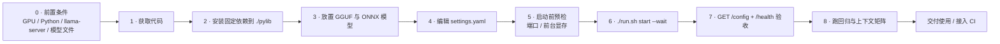

# explore 智能本地路由 — 部署与启动流程

> **English summary**: A complete, device-agnostic deployment runbook — prerequisites, the exact startup sequence, three hardware scenarios (multi-GPU NVIDIA / single AMD / small-VRAM single card), environment overrides, a first-boot acceptance checklist, regression commands, failure triage, upgrade/rollback, and CI wiring. Short version in [README.md](README.md); component rationale in [TECH_STACK.md](TECH_STACK.md).
>
> **版本** v2.3.0 ｜ **更新** 2026-11-08
> **核心原则**：不写死路径、不装系统服务、不设开机自启、不污染系统 Python 环境。

---

## 0. 部署全景 / Deployment map



全程**不需要修改任何 Python 代码**。换模型、换设备、换上下文、换端口都只改 `settings.yaml`。

---

## 1. 前置条件 / Prerequisites

### 1.1 硬件

| 项 | 要求 | 说明 |
|---|---|---|
| GPU | 可选：NVIDIA（CUDA）/ AMD（ROCm）/ 无 GPU（CPU） | 后端启动期自动探测；代码不假设卡数 |
| 显存 | 至少能装下 `front` 槽位 + 一个后台槽位 | 装不下时 `vram_plan` 会标记不可用并自动降级；**最低上下文 32K** |
| 内存 / 磁盘 | 能容纳 GGUF 权重与 SQLite/日志 | 模型文件由用户提供，不入库、不随仓库分发 |

> 显存大小由 `slots.<key>.vram_mb` 与 `budget` 估算判断，请按目标机实测填写「权重 + KV」。估算偏差过大会误判可用性。

### 1.2 软件

| 项 | 要求 | 检查命令 |
|---|---|---|
| 操作系统 | Linux（Ubuntu 22.04 实测） | `uname -a` |
| Python | 3.10+ | `python3 --version` |
| pip | 可用 | `python3 -m pip --version` |
| 推理运行时 | `llama-server`（llama.cpp，与目标 GPU 后端匹配的构建） | `<server_bin> --version` |
| GPU 工具 | `nvidia-smi` 或 `rocm-smi`（无 GPU 可缺） | `nvidia-smi` / `rocm-smi` |
| 基础命令 | `bash` / `curl` / `ss` 或 `netstat` | `command -v bash curl` |
| Git | 获取代码 | `git --version` |

**不需要**：`python3-venv`、root 权限、Docker、Redis、Celery、Ollama、任何云服务。

### 1.3 模型文件

按 `settings.yaml` 的 `slots.*.model` 与 `embedding.*` 准备：

| 类型 | 数量 | 放置位置 | 说明 |
|---|---|---|---|
| 前台 GGUF | 1 个 | `models/` | 轻量 Instruct（3B/4B 小量化）；`resident: true` |
| 中档 GGUF | 1 个 | `models/` | 8B/9B 等，可换成任意模型 |
| 重档 GGUF | 1 个 | `models/` | 30B/35B MoE 或稠密模型；小显存设备可移除该槽位 |
| ONNX 嵌入模型 + tokenizer | 1 套 | `models/embedding/...` | 当前中文 bge，1024 维，CPU 执行 |

> 模型文件与权重**不进 git**（`.gitignore` 已排除 `*.gguf` / `*.onnx`）。仓库只包含路径配置。

---

## 2. 目录结构 / Layout

```
explore-router/
├── settings.yaml          ★ 唯一配置源：槽位 / 模型 / 硬件 / 上下文 / 端口
├── requirements.txt       固定版本依赖
├── run.sh                 幂等启停（路径按脚本位置，端口读配置）
├── app/                   服务实现（config / gpu / llama / embed / store / router / main）
├── tests/                 回归 + 审计 + CI 脚本
├── .github/workflows/     GitHub Actions
├── models/                GGUF 与 ONNX（自行放置，不入库）
├── pylib/                 pip --target 安装的依赖（不入库）
├── data/                  state.db、router.pid（不入库）
├── logs/                  api.log / <slot>.log / matrix_*.json / audit_*.json（不入库）
├── docs/                  历史开发记录
└── *.md                   文档
```

`run.sh` 用 `$(dirname "${BASH_SOURCE[0]}")` 定位工作区，因此**仓库可以放在任意路径**；端口从 `app.config` 读取，可被环境变量覆盖。

---

## 3. 逐步部署 / Step-by-step

### Step 1 · 获取代码

```bash
git clone https://github.com/liuda1999/explore-router.git
cd explore-router
mkdir -p models pylib data logs
```

### Step 2 · 安装依赖（不污染系统）

```bash
python3 -m pip install --target ./pylib -r requirements.txt

# 国内网络可指定镜像源
python3 -m pip install --target ./pylib -i https://mirrors.aliyun.com/pypi/simple \
  -r requirements.txt
```

`run.sh` 会自动把 `./pylib` 加进 `PYTHONPATH`。若 `python3-venv` 不可用也不影响——本项目本来就不依赖 venv。

### Step 3 · 放置模型

把 GGUF 与 ONNX/tokenizer 放进 `models/`，然后确认路径与 `settings.yaml` 一致。示例：

```
models/front3b-q6.gguf
models/mid9b-q4.gguf
models/moe35b-q4.gguf
models/embedding/fast-bge-base-zh-v1.5/onnx/model_quantized.onnx
models/embedding/fast-bge-base-zh-v1.5/tokenizer.json
```

> 上列文件名只是 `settings.yaml` 里的**示例值**，请改成你自己的文件名。

### Step 4 · 编辑 `settings.yaml`（唯一必须改的地方）

按目标机实际情况填写，至少确认以下项：

| 字段 | 填什么 | 常见坑 |
|---|---|---|
| `runtime.server_bin` / `lib_dir` | `llama-server` 二进制与其动态库目录 | 路径写错 → 启动失败，看 `logs/<slot>.log` |
| `runtime.gpu_backend` | `auto`（推荐）或显式 `cuda` / `rocm` / `cpu` | 探测不到 GPU 时 `/config` 会显示 `cpu` |
| `runtime.ports` | 三个空闲端口 | `start` 会检查端口占用并明确报错，不要用全局清理 |
| `slots.*.model` | 你的 GGUF 相对路径 | 相对工作区根目录 |
| `slots.*.vram_mb` | **目标机实测**的权重 + KV 显存 | 不填则按 `weight_mb*1.35+512` 粗估，可能误判 |
| `slots.*.placement` | 单卡用 `auto`；多卡大模型可 `spread` | 单卡写了 `spread` 会自动退化，不会报错 |
| `slots.*.split_ratio` | 可选，多卡分层比例 | **换设备时删掉这行**，让程序按空闲显存自动算 |
| `slots.front.resident` | `true`，且全文件仅一个 `true` | 缺失或多个 → 启动直接失败 |
| `context.num_ctx` | `auto` 或整数（最低 32K） | `auto` 按 `auto_table` 查表，表可编辑 |
| `context.auto_table` | 按目标机显存校准 | 新设备建议实测后调整 |
| `routing.tier_to_slot` | 档位 → 槽位 key | 增删槽位时同步改；指向不存在的槽位会启动失败 |
| `embedding.onnx` / `tokenizer` | 你的嵌入模型路径 | 启动自检会输出维度；为 0 时看 `/health` 的 `embedding.error` |

配置会在启动时 fail-fast 校验：缺前台、多个 `resident: true`、档位名数量不符、映射不存在、分级阈值顺序错误，都会立即报错退出。

### Step 5 · 启动前预检

```bash
# 端口是否空闲（端口取自配置，可用 API_PORT 等环境变量覆盖）
(ss -tln 2>/dev/null || netstat -tln 2>/dev/null) | grep -E ':(8100|18100|18101) '

# 显存现状
nvidia-smi || rocm-smi || true

# 配置能否被正确解析（不启动服务）
python3 -c "from app import config; print(config.describe())"
```

`run.sh start` 自身也会做两件预检：端口占用检查、前台槽位显存预检。装不下时**直接报错退出**，不会加载到一半 OOM。

### Step 6 · 启动

```bash
./run.sh start --wait       # 幂等；--wait 等到前台就绪；不设开机自启
./run.sh status
./run.sh health
```

启动过程：拉起 `resident: true` 的前台槽位 → 后台槽位**懒加载**（第一个复杂任务时才启动）→ 写 `data/router.pid` → 日志写 `logs/api.log`。

> `run.sh` **不预设 `NUM_CTX` 默认值**，完全交给 `settings.yaml`；临时覆盖用 `NUM_CTX=65536 ./run.sh start`。

### Step 7 · 首次验收（必做）

```bash
# ★ 换模型/换设备后第一步：确认「实际生效」的配置
curl -s http://127.0.0.1:8100/config
curl -s http://127.0.0.1:8100/health
curl -s http://127.0.0.1:8100/gpu

# 简单任务：应为 process_mode=direct，且后台槽位未加载
curl -s -X POST http://127.0.0.1:8100/chat \
  -H 'Content-Type: application/json' \
  -d '{"user_input":"2+2 等于几","session_id":"deploy-check"}'

# 复杂任务：应返回 async + task_id，随后能取到非空 final_reply
curl -s -X POST http://127.0.0.1:8100/chat \
  -H 'Content-Type: application/json' \
  -d '{"user_input":"请详细分析并给出完整方案","session_id":"deploy-check","prefer_tier":"heavy"}'
curl -s 'http://127.0.0.1:8100/task_result?task_id=<上一步的 task_id>'

# OpenAI 兼容层：应返回虚拟模型名与标准 chat.completion 响应
curl -s http://127.0.0.1:8100/v1/models
curl -s -X POST http://127.0.0.1:8100/v1/chat/completions \
  -H 'Content-Type: application/json' \
  -d '{"model":"explore","messages":[{"role":"user","content":"2+2 等于几"}]}'

# Responses API：应返回 object=response 且 output[0].content[0].type=output_text
curl -s -X POST http://127.0.0.1:8100/v1/responses \
  -H 'Content-Type: application/json' \
  -d '{"model":"explore","input":"2+2 等于几"}'
```

**验收清单 / Acceptance checklist**

| # | 检查项 | 期望 |
|---|---|---|
| 1 | `/config` 的 `backend` / `gpu_count` | 与目标机一致；`num_ctx_source` 说明 N 的来源 |
| 2 | `/config` 的 `vram_plan` | 每个槽位 `available` 与 `reason` 合理；装不下的槽位明确标 false |
| 3 | `/health` 的 `frontend` | `ready` |
| 4 | `/health` 的 `embedding.dim` | 1024（非 0；否则看 `embedding.error`） |
| 5 | 三个实例的 `n_ctx_slot` | 与 `num_ctx` 一致（上下文恒定） |
| 6 | 简单任务 | `process_mode=direct`，`slot.switches` 不增加 |
| 7 | 复杂任务 | `process_mode=async`，`final_reply` 非空且为后台原始输出 |
| 8 | 进度提问 | 返回 `[后台任务进度]` 真实状态 |
| 9 | `/chat` 的 `context_usage` | `estimated_total_chars <= num_ctx` |
| 10 | `/v1/models`、`/v1/chat/completions`、`/v1/responses` | 返回 `explore` 等虚拟模型名；`object=chat.completion` / `response`，正文非空，`explore.task_id` 可查 |
| 11 | 停止后 | `./run.sh status` 显示 not running；本项目端口释放 |

### Step 8 · 回归测试

```bash
cd <工作区>
export PYTHONPATH=$PWD/pylib:$PWD

bash tests/ci_static.sh                  # 静态层：任意机器，无需 GPU
python3 tests/test_smoke.py              # 基础链路
python3 tests/test_slot_switch.py        # 槽位切换 / 上下文恒定
python3 tests/test_stability.py          # 连续请求
python3 tests/quick_check.py             # 主路快速检查（约 1 分钟）

CTX_MATRIX="32768 65536" ./tests/run_matrix.sh   # 档位按设备能力选，最低 32K

BASE=http://127.0.0.1:8100 ./tests/audit_runner.sh   # 全量真机审计
python3 tests/audit_single_gpu.py                    # 单卡/小显存阈值专项
```

测试脚本**从 `/config` 动态读取端口、槽位名、档位名**，换模型/换设备后无需修改。矩阵结果写 `logs/matrix_<ctx>.json`（含断言、速度、显存、生效配置、日志 `n_ctx_slot`）。

> 所有测试使用真实模型与真实进程，**不使用 mock**。历史报告中的 32K/64K/96K 与速度数字只对应当时的那台设备，换设备请用 `CTX_MATRIX` 选适合的档位重测。

---

## 4. 三种典型硬件场景 / Hardware scenarios

### 4.1 多卡 NVIDIA（CUDA）

```yaml
runtime:
  gpu_backend: auto
context:
  num_ctx: auto
slots:
  front: { ..., placement: auto, resident: true }
  mid:   { ..., placement: auto }
  moe:   { ..., placement: spread }      # 可选 split_ratio: [1, 2]
```

行为：前台常驻第一张卡；其它单卡槽位放最后一张卡避开前台；`spread` 槽位跨所有卡，比例按「各卡空闲显存 − 前台预估占用」自动算，也可显式写 `split_ratio` 覆盖。

### 4.2 单张 AMD（ROCm）

```yaml
runtime:
  gpu_backend: auto            # 探测到 rocm-smi 即使用 ROCm
context:
  num_ctx: auto                # 按该卡显存查 auto_table
slots:
  front: { ..., placement: auto, resident: true }
  mid:   { ..., placement: auto }
  moe:   { ..., placement: auto }        # 单卡不用 spread
```

启动期 `config.py` 会：探测后端 `rocm`、卡数 1 → 所有槽位 `devices=[0]` → 不启用多卡分层 → 进程环境用 `HIP_VISIBLE_DEVICES` / `ROCR_VISIBLE_DEVICES`。**无需改代码。**

> ROCm 已完成代码与配置解析层验证，尚未做 AMD 真机实测；部署到 A 卡时请先跑静态层 + 短集成，并校准 `vram_mb` / `auto_table`。

### 4.3 16G 单卡 / 小显存

```yaml
slots:
  front: {model: models/3b-q4.gguf,  vram_mb: 3200,  placement: auto, resident: true}
  mid:   {model: models/8b-q4.gguf,  vram_mb: 6800,  placement: auto}
  moe:   {model: models/14b-q4.gguf, vram_mb: 11500, placement: auto}   # 或直接移除重档
```

行为：`vram_plan` 按可见卡 `free_mb`、前台常驻占用与 `budget` 余量判断；装不下的槽位标 `available: false` 并给出原因，heavy 自动降级到 `routing.default_slot`（通常是 mid），`selection_reason` / `release_info` 写明「降级」。**不会强行加载导致 OOM**；连前台都装不下时服务启动直接失败并报原因。

单卡近似验证（在双卡机上限制可见卡）：

```bash
CUDA_VISIBLE_DEVICES=0 DATA_DIR=$PWD/data/single ./run.sh start --wait
curl -s http://127.0.0.1:8100/config | python3 -m json.tool | grep -A6 vram_plan
python3 tests/audit_single_gpu.py
```

### 4.4 无 GPU / CPU

探测不到 GPU 时后端标为 `cpu`，不设置可见设备变量，交给运行时。`n_gpu_layers` 会被运行时忽略。CPU-only 未跑全量功能，仅完成探测与显式设备越界检查。

---

## 5. 环境变量覆盖 / Environment overrides

优先级高于 `settings.yaml`，仅在部署期使用：

| 变量 | 覆盖内容 |
|---|---|
| `SETTINGS_FILE` | 配置文件路径 |
| `NUM_CTX` / `KV_CACHE` | 上下文长度 / KV 精度 |
| `GPU_BACKEND` / `N_GPU_LAYERS` | 后端 / 卸载层数 |
| `MAX_OUTPUT_TOKENS` / `QUEUE_MAXSIZE` / `FRONT_MAX_TOKENS` | 输出上限 / 队列上限 / 即时回复上限 |
| `API_PORT` / `FRONT_PORT` / `SLOT_PORT` | 三个端口 |
| `LLAMA_SERVER` / `LLAMA_LIB_DIR` | 运行时二进制 / 动态库目录 |
| `STARTUP_TIMEOUT_S` / `REQUEST_TIMEOUT_S` | 启动 / 请求超时 |
| `DATA_DIR` / `LOG_DIR` / `PID_FILE` / `LOG` | 数据 / 日志 / PID / 日志文件 |

示例：

```bash
NUM_CTX=65536 API_PORT=8200 ./run.sh start --wait
```

切换上下文档位需重启（`num_ctx` 是运行期常量）：

```bash
NUM_CTX=65536 ./run.sh stop && NUM_CTX=65536 ./run.sh start
curl -s http://127.0.0.1:8100/config | python3 -c "import json,sys; print(json.load(sys.stdin)['num_ctx'])"
```

---

## 6. 每次改配置后的固定动作

```bash
./run.sh stop && ./run.sh start --wait
curl -s http://127.0.0.1:8100/config     # ★ 确认生效值
python3 tests/quick_check.py
CTX_MATRIX="32768" ./tests/run_matrix.sh
```

改 `settings.yaml`、换模型、换设备、调 KV 参数、调 `vram_mb` 后都应重跑。**不要只改配置不看 `/config`。**

---

## 7. 启动失败速查 / Startup triage

| 现象 | 原因 | 处理 |
|---|---|---|
| `settings.yaml not found` | 配置缺失或路径不对 | 用 `SETTINGS_FILE` 指定，或放回工作区根目录 |
| `必须有一个 resident=true 的前台槽位` | slots 缺前台或有多个 | 保证有且仅有一个 `resident: true` |
| `ERROR: port ... already in use` | 端口被占 | 改 `runtime.ports` 或释放端口；**不要全局 `pkill`** |
| `ERROR: 前台槽位显存不足` | `vram_mb` 估算装不下 | 换更小模型/量化、校准 `vram_mb`、释放显存；不要强行启动 |
| `/config` 显示 `gpu_count=0` / `cpu` | 探测工具缺失或 GPU 不可见 | 检查 `nvidia-smi` / `rocm-smi`、`CUDA_VISIBLE_DEVICES`；必要时显式 `GPU_BACKEND` |
| 模型加载失败 | 路径错或架构不被运行时支持 | 看 `logs/<slot>.log` |
| `embedding.dim=0` | ONNX 路径/参数问题 | 看 `/health` 的 `embedding.error`，核对 `embedding.*` |
| 后台结果为空 | thinking 模型把正文写进 `reasoning_content` | 调用层已做 `enable_thinking=false` + `/completion` 兜底，勿删 |
| 大上下文 OOM | 前台 KV 挤占显存 | 调 `context.kv_cache`、`auto_table`、`placement`；不要改代码 |
| uvicorn 报 `ServerProtocol` | 系统 `websockets` 太旧 | 按 `requirements.txt` 把 `websockets` 装进 `pylib` |
| `NOT READY; see logs/api.log` | `--wait` 超时 | 看日志与 `startup_timeout_s`；大模型冷启动可调大超时 |
| 切换上下文档位不生效 | 未重启 | `num_ctx` 是启动期常量，必须 stop + start |

完整排障表见 [OPERATIONS.md](OPERATIONS.md) 第 11 节。

---

## 8. 停止、升级与回滚

```bash
./run.sh stop          # 只停本项目 PID 与配置中的 front/slot 端口
./run.sh restart --wait
```

**恢复语义**：启动时把残留 `processing` 标为 `failed`（含「服务重启，任务中断」），`pending` 重新入队；不会永久卡死。
**自愈语义**：前台进程异常时下一次 `/chat` 自动重启（默认 30s 冷却）；后台进程异常时下一次同档任务由 `ensure()` 拉起。

| 操作 | 做法 |
|---|---|
| 配置回滚 | 恢复 `settings.yaml` → `./run.sh stop && ./run.sh start` |
| 代码回滚 | 恢复 `app/` 或 `git checkout <commit>` → 重启 → 跑回归 |
| 版本升级 | `git pull` → 若 `requirements.txt` 变化则重装 `pylib` → 重启 → `/config` 确认 → 回归 |
| 数据重置 | 删 `data/state.db` 可重建（仅任务与会话记录）；**不要删 `models/`** |
| 卸载 | `./run.sh stop`，删除工作区；不装过任何系统服务，无需清理单元文件 |

备份：

```bash
tar -czf ~/explore-router-backup.tgz -C <工作区> \
  app tests settings.yaml run.sh requirements.txt .github \
  README.md PROJECT_INTRO.md PROJECT_INTRO.en.md TECH_STACK.md DEPLOYMENT.md \
  OPERATIONS.md AUDIT_REPORT.md TEST_REPORT.md docs
```

---

## 9. 接入 CI / CI wiring

[`.github/workflows/ci.yml`](.github/workflows/ci.yml) 定义两层：

| Job | Runner | 做什么 |
|---|---|---|
| `static` | `ubuntu-latest` | `bash tests/ci_static.sh`：语法、配置 fail-fast、可移植性、文档一致性、ruff |
| `integration` | `[self-hosted, linux, gpu]` | `bash tests/ci_integration.sh`：真实模型、独立端口与数据目录，结束自动停服 |

接入步骤：

1. 在一台已按本文部署好模型与 `pylib` 的 GPU 机器上安装 self-hosted runner，打上 `gpu` 标签；
2. 确认该机器不与其他实例共用同一组端口（集成层会用独立端口与数据目录）；
3. 在仓库设置里添加变量 `ENABLE_GPU_CI = true`；之后 push 到 `main` 会自动跑集成层。
   未配置该变量时，push 只跑 `static`（避免公开仓库里长期挂着一个排队中的 job）；
   手动 `workflow_dispatch` 无论变量是否设置都会执行集成层；
4. 期望输出 `STATIC_OK` 与 `INTEGRATION_OK`。

> 静态层不需要 GPU 与模型，**任何机器都能跑**；这也是换设备后建议先跑的第一步。

---

## 10. 部署纪律 / Operational rules

- **不写死路径**：工作区路径只由 `run.sh` 自身位置决定；模型/运行时路径只在 `settings.yaml`。
- **不装系统服务、不设开机自启**：服务只在主动 `start` 后存在。
- **不做全局清理**：禁止 `pkill -9 python`、禁止清运行时缓存；只用 PID 文件与配置端口管理。
- **不提交凭据与权重**：`.gitignore` 已排除 `.env`、私钥、`*.gguf`、`*.onnx`、日志、数据库。
- **默认只绑 `127.0.0.1`**：对外暴露必须加反向代理与鉴权、TLS；当前无鉴权、无速率限制。
- **长期运行**：外部配置 logrotate，定期归档 `data/state.db`。

---

## 11. 相关文档

- [README.md](README.md) — 双语总入口、快速开始
- [TECH_STACK.md](TECH_STACK.md) — 技术栈与兼容矩阵
- [PROJECT_INTRO.md](PROJECT_INTRO.md) / [PROJECT_INTRO.en.md](PROJECT_INTRO.en.md) — 设计、架构、取舍
- [OPERATIONS.md](OPERATIONS.md) — `settings.yaml` 字段全表、监控、排障、回滚
- [AUDIT_REPORT.md](AUDIT_REPORT.md) — 真机验证与 CI 结果
