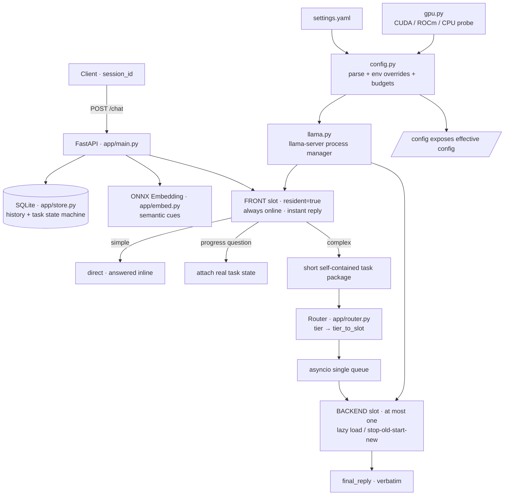

# explore · Intelligent Local LLM Router — Project Introduction

> **Version** v2.3.0 ｜ **Updated** 2026-11-08 ｜ **Configuration-driven edition**
> Workspace: `<deployment directory>` (scripts resolve paths from their own location; nothing is hard-coded)
> Bilingual entry point: [README.md](README.md) ｜ 中文版: [PROJECT_INTRO.md](PROJECT_INTRO.md)

---

## 0. Reading guide

| Question | Document |
|---|---|
| Should I use this, and how do I run it quickly? | [README.md](README.md) (bilingual) |
| Full design, architecture, trade-offs, boundaries | This document |
| Which components, why they were chosen, version matrix | [TECH_STACK.md](TECH_STACK.md) |
| From zero to the first request; migrating to another device | [DEPLOYMENT.md](DEPLOYMENT.md) |
| Day-2 operations, swapping models, troubleshooting, rollback | [OPERATIONS.md](OPERATIONS.md) |
| What was actually tested and what the results were | [AUDIT_REPORT.md](AUDIT_REPORT.md) |
| What a specific configuration field means | [OPERATIONS.md](OPERATIONS.md) §4 + [settings.yaml](settings.yaml) |

---

## 1. One-line positioning

**An intelligent router that runs on your own hardware.** A small, always-resident front model holds the conversation with the user at all times. Once it understands the intent, it dispatches work that genuinely needs compute to a more suitable model in a backend slot, chosen against live device resources, and hands the result back verbatim.

The value is in **"understand intent → assess resources → pick the right model → keep the chain working"**. It is not a model server, not a chat UI, and not tied to any particular hardware.

Three properties must hold simultaneously:

- **Always online** — every user message gets an immediate answer from the front model. There is never a silent gap while a large model loads.
- **Bounded resources** — at most one large backend model is resident at any moment; tiers that do not fit are degraded automatically, so one complex request cannot exhaust VRAM.
- **Configuration is the product** — swapping models, GPUs, context length, ports, or even adding/removing slots only requires editing `settings.yaml`. No Python changes.

---

## 2. Background and design constraints

The project began with a practical constraint: a single 16 GB GPU cannot hold several large models at once. We wanted a small model for instant answers and a larger one for real work, but they could not both stay resident. The rewrite generalised that experience into two durable principles:

1. **A slot is a role, not a model.** Front / middle / heavy are roles. Which GGUF file, which quantisation, how much VRAM it needs, and which GPU it lands on are all declared in `settings.yaml`. Slot keys (`front` / `mid` / `moe`) are historical identifiers — they do not imply a model type, and the number of slots is not fixed at three.
2. **Hardware is a runtime fact, not a code constant.** GPU count, vendor (NVIDIA / AMD), backend (CUDA / ROCm), free VRAM and the context ceiling are probed at startup. One card, two cards, a different machine, or no GPU at all require **zero code changes**.

> The project was validated on one dual-GPU machine (see [TEST_REPORT.md](TEST_REPORT.md) and [AUDIT_REPORT.md](AUDIT_REPORT.md)). Those numbers are **historical measurements of that device** — not fixed configuration, not capability limits, and not requirements for other machines.

### Deliberate non-goals

| Not doing | Why |
|---|---|
| Cross-session history retrieval / vector store | The main session belongs to the front model; the backend is a stateless executor. A retrieval layer adds consistency and VRAM cost for unclear benefit |
| 8K / 16K small-window compatibility | The project's **minimum is 32K**; no down-compatibility branch |
| Hard-coding "three models", "two GPUs" or a GPU model | Future devices may use any small quantised 3B/4B, 8B/9B, 30B/35B MoE models, or a single 16 GB AMD / NVIDIA card |
| Unloading backend models immediately after use | One middle/heavy tier may stay resident and is only replaced when another tier is needed, reducing repeated prefill |

---

## 3. Design goals

| # | Goal | Implementation |
|---|---|---|
| 1 | **Every message gets a reply** | The front model produces an `instant_reply` on every request, without waiting for the backend |
| 2 | **Zero switching for simple work** | Requests routed to front use `process_mode=direct`; no backend process loads |
| 3 | **Mutually-exclusive backend slot** | A single asyncio queue executes serially, so slots are naturally exclusive |
| 4 | **Constant context window** | `num_ctx` is resolved once at startup and applied to every instance; model switches never change it |
| 5 | **Verbatim result delivery** | Backend output is written to `final_reply` unchanged — no rewriting, no summarising |
| 6 | **Observable progress while waiting** | Progress questions attach the real task state instead of a generated guess |
| 7 | **No VRAM overflow on small devices** | `vram_plan` automatic thresholds + degradation; history budget scales with `num_ctx` |
| 8 | **Clear config, stable structure, reliable** | One source of truth; code knows role keys, never model names or GPU indices |
| 9 | **Observable, infrequent switching** | Same-tier jobs do not increment `slot.switches`; reasons go into `selection_reason` / `release_info`; real prefill time is recorded |
| 10 | **Working chain over feature count** | No over-engineering; correctness of the pipeline comes first |

---

## 4. System architecture



### Module responsibilities

| File | Responsibility | Explicitly does not contain |
|---|---|---|
| `app/config.py` | Read `settings.yaml`, apply env overrides, probe backend, resolve `num_ctx`, compute history budget and `vram_plan`, derive slot devices and split ratios, `describe()` | Concrete model names or GPU indices |
| `app/gpu.py` | GPU snapshot: backend, visible devices, model names, total/free VRAM; honours `CUDA_VISIBLE_DEVICES` / `HIP_VISIBLE_DEVICES` | Vendor-specific constants |
| `app/llama.py` | Start/stop `llama-server`, port readiness, runtime VRAM re-check, chat with `/completion` fallback, disable thinking, KV precision and multi-GPU split flags | Hardware feasibility decisions |
| `app/embed.py` | ONNX embedding load + inference, startup self-check of vector dimension (currently 1024) | Task classification |
| `app/store.py` | SQLite `messages` / `tasks`; merge consecutive same-role messages, budget-truncate and normalise history, task state machine, restart recovery | Cross-session retrieval |
| `app/router.py` | Classification, `tier_to_slot` mapping, static `VRAM_PLAN` selection/degradation, mutually-exclusive `ensure()` | Assumption that exactly three slots exist |
| `app/prompts.py` | **Central message templates**: backend system, task package, result/progress prefixes, truncation marker, degradation text; `PROMPT_VERSION` identifies the revision | No routing decisions, no config access |
| `app/main.py` | FastAPI endpoints, instant reply, progress attachment, enqueue, worker, verbatim result, `context_usage`, error codes | Hardware logic beyond resolved config |
| `run.sh` | Idempotent start/stop, workspace resolved from script location, ports from config, pre-start VRAM check | Hard-coded paths, global `pkill` |

**Layering rule**: `gpu.py` observes → `config.py` decides → `llama.py` executes. No layer needs to know what another machine looks like.

---

## 5. Technology stack

| Layer | Choice | Role |
|---|---|---|
| API framework | FastAPI 0.162.0 / Uvicorn 0.54.0 (single worker) | HTTP contract, lifespan hooks, in-process queue |
| Async HTTP | httpx 0.28.1 | Calls the local `llama-server` |
| WS compatibility | websockets 16.1.1 | Avoids conflicts with an outdated system-wide version |
| Inference runtime | `llama-server` (llama.cpp, CUDA/ROCm build), GGUF | Loads weights, exposes OpenAI-compatible endpoints |
| GPU backends | CUDA / ROCm / CPU, probed at startup | Determines visibility variables and offload layers |
| Embedding | ONNX Runtime 1.23.2 + tokenizers 0.23.3, Chinese bge, 1024-d, CPU provider | Semantic cues, no VRAM usage |
| State | SQLite via stdlib `sqlite3` | History, task state machine, restart recovery |
| Config | PyYAML 6.0.3 | Parses the single source of truth |
| Numeric | numpy 2.2.6 | Embedding vectors |
| Concurrency | `asyncio.Queue` + single worker | Serial backend execution, natural mutual exclusion |
| Process control | Bash + PID file + port probing | Idempotent lifecycle, no system service |
| Test / CI | pytest 9.2.0, real-machine Python/Shell audits, GitHub Actions | Static layer anywhere, GPU integration on self-hosted runner |

All dependency versions are pinned in [requirements.txt](requirements.txt) and installed with `pip --target ./pylib` — **no system pollution, no venv, no root**. Full rationale, alternatives, and the compatibility matrix are in **[TECH_STACK.md](TECH_STACK.md)**.

### 5.1 Message contract and standard templates

Every cross-module message is produced by `app/prompts.py`; `PROMPT_VERSION` identifies the template revision. Changing a template touches exactly one file.

| Message | Produced by | Shape | Written to history? |
|---|---|---|---|
| Front conversation | assembled in `main.py` | `[system] + history + [user]`, strictly alternating roles | Yes (clean reply only, no progress note) |
| Backend task package | `prompts.backend_messages()` | `[system] + [user]`; the user turn is three fixed-order sections: task / semantic cues / requirements | No |
| Backend result (API) | `tasks.final_reply` | raw model output, zero rewriting | — |
| Backend result (history) | `prompts.history_message()` | `[后台结果] ` + raw output | Yes |
| Progress note | `prompts.progress_note()` | `[后台任务进度] ` + real task state | No (instant reply only) |
| Front degradation | `prompts.front_failure()` | fixed sentence with exception type, no stack trace | Yes (as a clean reply) |
| Oversized input | `prompts.TRUNCATION_MARK` | keeps first 2/3 and last 1/3, marks the cut | No (task package only) |
| History truncation | `prompts.HISTORY_TRUNCATED_NOTE` | fixed notice that earlier records are unavailable and must not be replaced or guessed | No (system only) |

Three hard constraints:

1. **`final_reply` is always the raw model output** — no prefix ever enters that field.
2. **Prefixes belong to history or instant replies only**, never to the API result body.
3. **Roles written to history must alternate user / assistant**: `store.append_message()` merges consecutive same-role messages, and `get_history()` drops orphaned roles at both ends, preventing chat-template 500s.

---

## 6. Lifecycle of one request

| Step | Action | Output |
|---|---|---|
| 1 | Client sends `POST /chat` with `user_input`, optional `session_id` / `prefer_tier` | Request |
| 2 | Load history and recent tasks; embedding produces semantic cues; compute `context_usage` against `num_ctx` | History window, budget |
| 3 | **Front model immediately generates `instant_reply`**, without waiting; progress questions get the real `[后台任务进度]` task state attached | Instant reply |
| 4 | `Router.classify()` yields a tier; `tier_to_slot` maps it to a slot key; insufficient VRAM degrades via `VRAM_PLAN` with a recorded reason | `tier`, `selection_reason` |
| 5 | Mapped to front → `process_mode=direct`, return immediately, **zero loading** | Response |
| 6 | Mapped to a backend slot → create task (SQLite `pending`) → enqueue → return `async` + `task_id` + `queue_position` | Task ID |
| 7 | Worker dequeues serially; `SlotManager.ensure()` checks whether the resident model matches and only swaps when needed; `llama.py` re-checks VRAM before actually loading | Slot instance |
| 8 | Build a **self-contained short task package** (task description + keywords + output requirements), not the full conversation | Prompt |
| 9 | Backend output is written **verbatim** to `final_reply`, status becomes `completed`; elapsed time, real prefill and chosen slot are recorded | Result |

The client polls `/task_result` and may ask for progress at any time. Serial execution makes the backend slot naturally exclusive — no Redis, Celery, or distributed lock.

### State machine and self-healing

- Task: `pending` → `processing` → `completed` / `failed`, persisted at every step.
- **Restart recovery**: leftover `processing` tasks become `failed` (error mentions "service restart, task interrupted"); `pending` tasks are re-enqueued, so nothing is stuck forever.
- **Front self-healing**: after an abnormal exit, the next `/chat` restarts the front model (cooldown `frontend.restart_cooldown_s`, default 30s).
- **Backend self-healing**: after an abnormal exit, the next same-tier task is relaunched by `ensure()`; a failed swap clears `current` / `server` and records `last_error`.

---

## 7. The single source of truth: `settings.yaml`

| Section | Purpose | Key point |
|---|---|---|
| `runtime` | Server binary, lib dir, backend preference, ports, timeouts, limits | `n_gpu_layers` / `max_output_tokens` / `queue_maxsize` all configurable |
| `context` | `num_ctx`, `kv_cache`, `auto_table` | Minimum 32K; `auto` looks up device total VRAM, or set an integer |
| `embedding` | ONNX and tokenizer paths | Swapping the embedding model touches only this section |
| `budget` | System VRAM reserve and safety headroom | A slot that does not fit is marked unavailable instead of being force-loaded |
| `slots` | **Role slot dictionary** | `model / quant / weight_mb / vram_mb / placement / split_ratio / resident`; exactly one `resident: true` required |
| `routing` | `tier_order`, `tier_to_slot`, thresholds, complex-word list, input cap | Add/remove slots or rename tiers here only |
| `frontend` | Front prompt, reply cap, **automatic history budget**, restart cooldown, progress window | History scales with `num_ctx`; no fixed message count |

**Environment variables (deployment-time overrides, highest priority)**: `SETTINGS_FILE`, `NUM_CTX`, `KV_CACHE`, `GPU_BACKEND`, `N_GPU_LAYERS`, `MAX_OUTPUT_TOKENS`, `QUEUE_MAXSIZE`, `FRONT_MAX_TOKENS`, `API_PORT`, `FRONT_PORT`, `SLOT_PORT`, `LLAMA_SERVER`, `LLAMA_LIB_DIR`, `STARTUP_TIMEOUT_S`, `REQUEST_TIMEOUT_S`, `DATA_DIR`, `LOG_DIR`, `PID_FILE`, `LOG`.

`GET /config` returns the **effective** configuration: detected backend and GPU count, `num_ctx_source` (table lookup / file / env override), each slot's `devices` and `split_ratio`, and `vram_plan` availability with reasons. **Check it first after any model or device change.**

Configuration fails fast at startup: missing front slot, multiple `resident: true`, mapping to a non-existent slot, invalid threshold ordering, or a wrong number of tier names all abort immediately rather than running in a broken state.

---

## 8. Swappable slots, models and runtime

**Slot keys are identifiers only** (currently `front` / `mid` / `moe`, historical names that imply nothing about model type). To change a model, edit `slots.<key>`:

```yaml
slots:
  front:
    model: models/another-4b-q4.gguf     # any small 3B/4B quantised model
    quant: Q4_K_M
    weight_mb: 2600                      # used for multi-GPU split deduction, approximate
    vram_mb: 3800                       # measured weights + KV on the target machine
    placement: auto
    resident: true
```

| Change | Edit only | Code change? |
|---|---|---|
| Swap the front model (3B ↔ 4B, different quant) | `front.model` / `quant` / `weight_mb` / `vram_mb` | No |
| Swap middle / heavy (8B ↔ 9B, 30B/35B MoE ↔ dense) | Same fields on that slot | No |
| Add/remove slots, rename tiers | `slots` + `routing.tier_to_slot` (+ `tier_order`) | No |
| Swap inference runtime | `runtime.server_bin` / `lib_dir` | No (isolated in `app/llama.py`) |
| Swap embedding model | `embedding.onnx` / `tokenizer` | No |
| Change device (single AMD / single NVIDIA / multi-GPU / no GPU) | `gpu_backend: auto` is enough; optionally tune `placement` and `vram_mb` | No |
| Change context tier | `context.num_ctx` or `auto_table` / `NUM_CTX` | No |

Then: edit config → restart → `GET /config` → run regression ([DEPLOYMENT.md](DEPLOYMENT.md) §6).

---

## 9. Hardware adaptation and automatic thresholds

| Situation | Automatic behaviour |
|---|---|
| Single NVIDIA card | All slots get `devices=[0]`; no multi-GPU split |
| Single AMD card | Backend detected as `rocm`; visibility switches to `HIP_VISIBLE_DEVICES` / `ROCR_VISIBLE_DEVICES` |
| Multi-GPU | Front stays on the first card; other single-card slots go to the last card to avoid it; `placement: spread` spans all cards with a ratio computed from "free VRAM − estimated front usage", overridable via `split_ratio` |
| Restricted visibility | Honours `CUDA_VISIBLE_DEVICES` / `HIP_VISIBLE_DEVICES`; a container with one card is planned as a single-card device |
| **Insufficient VRAM** | `vram_plan` uses visible-card `free_mb`, front residency and `budget` headroom; a slot that does not fit is `available: false` with a `reason`, and heavy requests degrade to `default_slot` — **never a forced OOM** |
| Front does not fit | Startup fails with an explicit reason (`run.sh start` pre-check) |
| No GPU | Backend marked `cpu`; no visibility variables are set; the runtime decides |
| Context ceiling | `num_ctx: auto` looks up `auto_table` by total VRAM (minimum 32K); the table is editable, and `NUM_CTX` can override |

Important implementation detail: slot selection uses a **static `VRAM_PLAN`** so the model that is about to be swapped out is not mistakenly counted as occupied (which caused false degradation). `llama.py` performs a second, runtime VRAM check immediately before loading.

There are **no** `0,1`, `1:2`, GPU model names or CUDA version constants in the code. Such values may only appear as examples in `settings.yaml` or in historical test reports. The CI static layer includes a dedicated portability check to prevent regression.

---

## 10. Context strategy and automatic history budget

Once resolved, `num_ctx` is a **runtime constant** applied uniformly to every instance; it is never changed per request. Re-prefill after a model switch is accepted, but kept rare by never switching for same-tier jobs and allowing a backend model to stay resident. Real prefill time and `slot.switches` are recorded for observability.

The history budget is dynamic rather than a fixed message count:

```
available       = num_ctx - max_output_tokens - context_safety_tokens - len(system_prompt)
history_budget  = max(history_min_chars, (available - len(current_input)) * history_budget_ratio)
```

- Short inputs carry more history; long inputs tighten it automatically. `history_max_messages` prevents extreme multi-turn sessions from slowing prefill.
- `store.py` truncates and normalises history: consecutive same-role messages are merged and an orphaned leading assistant message is dropped, preventing some GGUF Jinja templates from returning 500 on non-alternating roles.
- `/chat` returns `context_usage`, making "estimated total characters ≤ num_ctx" observable.
- `routing.max_input_chars` defaults to `auto` (available context − minimum history budget); exceeding it returns `413`.

> Passing 32K / 64K / 96K is a **measurement from one dual-GPU machine on 2026-11-06**, not a project requirement. On a new device, use `CTX_MATRIX="..."` to test suitable tiers and calibrate `auto_table`.

---

## 11. HTTP interface

Two entry points share one orchestration layer (`app/main.py::_pipeline`): `/chat` is the custom "instant reply + task_id" protocol, `/v1/*` is the OpenAI-compatible layer for standard clients. Routing, context budgeting, degradation and verbatim result pass-through are identical — only the wire format differs.

| Endpoint | Description |
|---|---|
| `POST /chat` | Body `{user_input, session_id?, prefer_tier?}`; returns `instant_reply`, `process_mode`, `task_id`, `num_ctx`, `queue_position`, `context_usage` |
| `POST /v1/chat/completions` | OpenAI-compatible; standard request in, standard response or SSE out |
| `GET /v1/models` | Virtual model names: `explore` (auto), `explore-fast` (instant reply only), `explore-<tier>` |
| `GET /task_result` | Status, progress, `final_reply` (verbatim), chosen slot, real prefill time, error info |
| `GET /health` | Backend, `num_ctx`, front, slot, queue, embedding (1024-d self-check), VRAM, config summary |
| `GET /config` | **Effective configuration** — check after every model/device change |
| `GET /gpu` | Per-card model / VRAM / driver |
| `GET /tasks` | Recent tasks (`limit` 1–200) |

**Error contract**: empty input `400`; oversized input `413` (`routing.max_input_chars`); invalid `prefer_tier` `400`; queue full `429` (`runtime.queue_maxsize`); unknown task returns `code=404`. `/v1/*` uses the OpenAI error body `{"error":{message,type,param,code}}` and returns `502` when the backend task fails.

Valid `prefer_tier` values come from the keys of `routing.tier_to_slot` (default `simple/mid/heavy`, renamable via `tier_order`). For complex tasks, `final_reply` is the backend model's **raw output**. Ports, backend, slots and models all come from configuration; numeric values in this document are default examples.

### 11.1 OpenAI-compatible layer

The custom `/chat` protocol ("instant reply + background task") is not something Cherry Studio, Open WebUI or Dify understand. This layer **does not duplicate business logic** — it only converts protocols, and both entry points call the same `_pipeline()`.

**Model name mapping**

| Requested `model` | Behaviour |
|---|---|
| `explore` / `explore-auto` / anything unrecognised (e.g. `gpt-3.5-turbo`) | Automatic classification; no error |
| `explore-simple` / `explore-mid` / `explore-heavy` | Force a tier (values come from `routing.tier_order`) |
| `explore-front` / `explore-mid` / `explore-moe` | Reverse-lookup the tier from a slot name |
| `explore-fast` | Automatic classification + instant reply only |

Unrecognised model names are **not rejected** — they fall back to automatic routing, because many clients hard-code names such as `gpt-3.5-turbo`.

**Two return modes**

| Mode | How to select | Behaviour |
|---|---|---|
| `final` (default) | `explore_mode=final` / `X-Explore-Mode: final` / omitted | Blocks until the backend finishes (`openai.wait_timeout_s`, default 120s); `content` is the complete result. On timeout it falls back to the instant reply and sets `explore.fallback=timeout` |
| `instant` | `explore_mode=instant` / `X-Explore-Mode: instant` / model suffixed `-fast` | Returns the instant reply immediately; `explore.task_id` can be polled via `/task_result` |

Precedence: `explore_mode` > `X-Explore-Mode` > model suffix > `openai.default_mode`.

**Streaming**: `stream=true` returns SSE. The instant reply is streamed first to keep first-token latency low; once the backend finishes, the final result is appended after a blank line. `stream_options.include_usage=true` adds a trailing usage frame. This is **chunked delivery, not token-by-token streaming** — the upstream `llama-server` call is `stream=false`; chunking only provides protocol compatibility.

**Conversation semantics**: when `messages` carries history, the server is stateless and does not read SQLite. Only when a single user message is sent with `X-Session-Id` (or the `user` field) does it read server-side history. `system` messages are appended to the front model's system prompt rather than replacing the routing persona.

**`explore` extension fields**: `task_id`, `task_status`, `process_mode` (direct/async), `tier`, `chosen_slot`, `instant_reply`, `queue_position`, `degraded`, `history_truncated`, `num_ctx`, `selection_reason`; timeouts also carry `fallback` and `hint`.

**Trade-offs**: `temperature` / `max_tokens` are echoed but not applied — sampling is controlled server-side by configuration. `usage` is estimated from character counts (roughly 1 token per 1.5 CJK characters), not exact tokenizer output.

### 11.2 Responses API

`POST /v1/responses` is OpenAI's newer protocol. It is a **structural** difference from chat/completions, not an alias:

| Dimension | Chat Completions | Responses |
|---|---|---|
| Input | `messages[]` | `input` (string or message array) + `instructions` |
| Output | `choices[].message.content` | `output_text` inside `output[]` |
| Termination | `finish_reason` | `status` + `incomplete_details` |
| Multi-turn | Client resends the full `messages` | `previous_response_id` lets the server continue |
| Streaming | `data:` frames + `[DONE]` | `event:` + `data:` typed events, **no `[DONE]`** |

**What is supported**

- `input` accepts a string or a message array; `content` accepts strings and `input_text` / `output_text` parts. `system` / `developer` messages and `instructions` are merged and appended to the front model's system prompt.
- `model` mapping is identical to 11.1; `explore-fast` or a `-fast` suffix selects instant mode.
- `store` defaults to `true`: `response_id → session_id` plus input/output are persisted in a dedicated SQLite table `responses` (`CREATE TABLE IF NOT EXISTS`, no ALTER on existing tables).
- `previous_response_id` looks up the original session and reads server-side history; an unknown id returns `404` + `previous_response_not_found`.
- `GET /v1/responses/{id}` returns a stored response; requests sent with `store=false` are not retrievable (`404`).
- `stream=true` emits the full event sequence `response.created` → `in_progress` → `output_item.added` → `content_part.added` → `output_text.delta`… → `output_text.done` → `content_part.done` → `output_item.done` → `response.completed`, each frame carrying `sequence_number`.

**Trade-offs shared with 11.1**

- `max_output_tokens` / `temperature` are echoed but not applied — sampling is server-configured.
- `usage` is estimate-based: `input_tokens` / `output_tokens` / `total_tokens`, with `*_details` placeholders.
- On backend wait timeout the response is `status="incomplete"` with `incomplete_details.reason="timeout"` — it **does not claim `completed`**; `explore.fallback=timeout` is set and the task keeps running.

**Explicitly not implemented**: tool calling (`tools` / `tool_choice`), structured outputs (`text.format`), `reasoning`, `truncation`, `background` mode, and non-text modalities such as `input_image` / `input_file`. Those fields are accepted but inert, or treated as plain text — this covers the text chat path, not the full Responses specification.

---

## 12. Quality assurance: tests and CI

**Principle: real hardware, real models, real process crashes, real restarts — no mocks or simulated data.**

| Layer | Content | Entry point |
|---|---|---|
| Static (any machine, no GPU) | Python/Shell syntax, config parsing and fail-fast, portability (no device/model hard-coding), documentation consistency, ruff | `bash tests/ci_static.sh` |
| GPU integration (self-hosted runner) | Basic chain, slot switching, stability, context matrix, long-context recall, fault injection, restart recovery, single-card thresholds | `bash tests/ci_integration.sh` |
| Full audit | API contract, concurrency, content correctness, real SIGKILL, real restart | `BASE=http://127.0.0.1:8100 ./tests/audit_runner.sh` |

GitHub Actions is defined in [`.github/workflows/ci.yml`](.github/workflows/ci.yml): `static` runs on `ubuntu-latest`; `integration` runs on a self-hosted runner tagged `gpu`, with dedicated ports and data directory, stopping the service afterwards and never sharing ports with a production instance. Set the repository variable `ENABLE_GPU_CI` to `true` to have pushes to `main` trigger it automatically (otherwise a public repository would show a permanently queued job); a manual `workflow_dispatch` always runs it. See [DEPLOYMENT.md](DEPLOYMENT.md) §9.

Verified: API 27/27, fault injection 10/10, restart recovery 10/10, stability 10/10, long context 15/15 per tier, 32K/64K/96K matrix 69/69, single-card degradation chain, CI `STATIC_OK + INTEGRATION_OK`. See [AUDIT_REPORT.md](AUDIT_REPORT.md).

---

## 13. Design trade-offs

| Decision | Reason | Boundary |
|---|---|---|
| Config-driven slots and hardware | Swap models/devices without code changes | Config changes require restart + regression |
| Resident front + single backend slot | "Always interactive" and "continuous context" at once | Backend jobs are serial |
| Short task package, not full conversation | Main session belongs to front; backend is stateless | Backend cannot see full history |
| Disable thinking | Some GGUFs put the body into `reasoning_content`, leaving `content` empty | `chat_template_kwargs` + `/completion` fallback |
| Configurable KV cache precision | Larger contexts make the resident front's KV compete with backend VRAM | Compresses KV only; `num_ctx` unchanged |
| Verbatim result delivery | Explicit requirement: "no rewriting, just hand it back" | Backend tone may differ from front |
| Static VRAM plan + pre-load re-check | Avoids counting the soon-to-be-swapped model as occupied | `vram_mb` is an estimate, calibrate by measurement |
| `llama-server` instead of a managed service | Direct GGUF loading, no download, no daemon | Isolated in `app/llama.py`, replaceable |
| Single-process asyncio queue + SQLite | Eliminates quota leaks, unclosed states, broken concurrency | Single-machine deployment, no horizontal scaling |

---

## 14. What was fixed compared with the earlier implementation

| Earlier problem | Now |
|---|---|
| VRAM quota only ever increased | No logical counter; real VRAM comes from runtime probing |
| Sync success never wrote `completed` | Unified state machine, persisted in SQLite |
| Backend detection tied to one tool | CUDA / ROCm / CPU abstraction, probed per device |
| Conflicting threshold semantics; complex tasks had the loosest threshold | Configurable classification with startup validation |
| No `num_ctx` / no session state | Global constant + SQLite history |
| Generative small model used for template splitting | ONNX embedding semantic decomposition |
| Global `pkill -9 python` / boot autostart | Precise PID-file management, no autostart |
| Crashes never recovered; tasks stuck after restart | Front auto-restart; interrupted tasks marked failed, pending re-enqueued |
| No input/queue limits | `max_input_chars` (413) and `queue_maxsize` (429) |
| Model names and GPU indices hard-coded in code | All externalised to `settings.yaml`; code only knows role keys |
| Non-alternating multi-turn roles caused 500 | `store.py` merges same-role messages and normalises history |

---

## 15. Known limitations

- **Model quality**: with the example configuration, the 9B middle model often returns 15–22 characters and sometimes repeats the input; the 35B MoE also returns only ~20 characters for "one sentence each" requests. This is a model-quality issue — swap in a stronger model or tune prompts; the pipeline is unaffected.
- **Weak instruction following in the small front model**: progress information is guaranteed by the API layer attaching real state; when reading back a backend result the front may occasionally invent "still processing" — **trust `final_reply`**.
- **`num_ctx: auto` is a heuristic lookup**, not an exact VRAM solver; calibrate `auto_table` on a new device.
- **AMD ROCm** is validated at the code and config-parse layers but **not yet on physical AMD hardware**; run the static layer plus a short integration on the target machine before production.
- **16 GB single-card** was not validated on a real 16 GB card; the "heavy unavailable → automatic degradation" chain was verified on a dual-GPU machine with only one 20 GB card exposed.
- **`vram_mb` is an estimate** for weights + KV; calibrate it on the target machine. Large errors can misjudge availability.
- **Early history is not recallable, and the model may answer incorrectly**: turns outside the budget are dropped, `context_usage.history_truncated` is set to `true`, and the system prompt states that earlier records are unavailable. Real-machine testing nevertheless showed the lightweight 3B front model can mistake a recent turn for an earlier one and answer confidently. **Do not rely on early recall after truncation**; keep the original record client-side if exact recall matters. This is the cost of not adding a retrieval layer.
- **No streaming output**; long tasks require polling `/task_result`.
- **No authentication or rate limiting**; binds to `127.0.0.1` by default. Any external exposure needs a reverse proxy with auth and TLS.
- **No automatic log/SQLite rotation**; long-running deployments need external logrotate and periodic archiving.
- **No hour-scale stress test / VRAM leak test**; CPU-only has not run the full functional suite.
- Performance figures in historical reports belong to that one device and are not an SLA.

---

## 16. Roadmap (non-binding)

| Direction | Note |
|---|---|
| Physical AMD ROCm validation | Static layer + short integration on a single 16 GB AMD card; calibrate `vram_mb` and `auto_table` |
| Streaming output | SSE for front replies and backend results, reducing polling |
| Auth and rate limiting | Minimal security layer for non-localhost access |
| Operational hardening | Log rotation, DB archiving, metrics export |
| More precise VRAM planning | Replace `vram_mb` estimates with actual runtime usage |
| Prompt / output quality | Adjustable templates for short replies and tone mismatch, without changing verbatim delivery semantics |

---

## 17. Documentation index

| Document | Content |
|---|---|
| [README.md](README.md) | Bilingual entry point (EN / 中文) |
| [PROJECT_INTRO.en.md](PROJECT_INTRO.en.md) | This file — full English introduction |
| [PROJECT_INTRO.md](PROJECT_INTRO.md) | 完整中文项目介绍 |
| [TECH_STACK.md](TECH_STACK.md) | Technology stack, choices, version matrix |
| [DEPLOYMENT.md](DEPLOYMENT.md) | Deployment & startup runbook, hardware scenarios, acceptance checklist |
| [OPERATIONS.md](OPERATIONS.md) | Day-2 operations, model/device swaps, monitoring, troubleshooting, rollback |
| [AUDIT_REPORT.md](AUDIT_REPORT.md) | Full real-machine audit and CI results |
| [TEST_REPORT.md](TEST_REPORT.md) | Historical device-specific measurements |
| [docs/PROJECT_PLAN.md](docs/PROJECT_PLAN.md) | Historical development log (not a current constraint) |
| [settings.yaml](settings.yaml) | **The single source of truth** |
| [LICENSE](LICENSE) | Apache License 2.0 |
