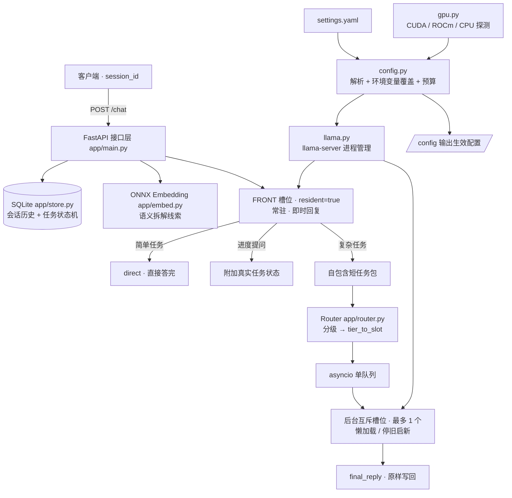

# explore 智能本地路由 — 项目介绍

> **版本** v2.2.0 ｜ **更新** 2026-11-06 ｜ **配置驱动版**
> 工作区：`<部署目录>`（脚本按自身位置定位，不写死路径）
> 双语入口：[README.md](README.md) ｜ English edition: [PROJECT_INTRO.en.md](PROJECT_INTRO.en.md)

---

## 0. 阅读指引

| 你想知道什么 | 看哪里 |
|---|---|
| 这个项目值不值得用、怎么快速跑起来 | [README.md](README.md)（双语） |
| 整体设计、架构、取舍、边界 | 本文档 |
| 用了哪些组件、为什么这么选、版本矩阵 | [TECH_STACK.md](TECH_STACK.md) |
| 从零部署到第一个请求、换设备怎么办 | [DEPLOYMENT.md](DEPLOYMENT.md) |
| 日常运维、换模型、排障、回滚 | [OPERATIONS.md](OPERATIONS.md) |
| 到底测过什么、结果如何 | [AUDIT_REPORT.md](AUDIT_REPORT.md) |
| 某个配置项怎么填 | [OPERATIONS.md](OPERATIONS.md) 第 4 节 + [settings.yaml](settings.yaml) |

---

## 1. 一句话定位

**一个跑在本地设备上的智能路由**：前台常驻模型始终与用户对话，理解意图后，依据设备实时资源把真正需要算力的任务交给后台槽位里更合适的模型，结果原样递回。

核心价值是「**理解意图 → 评估资源 → 选对模型 → 保证链路通畅**」。它不是某个模型服务，不绑定某套硬件，也不是聊天前端。

三个必须同时成立的性质：

- **始终在线**：用户说的每一句话都由前台模型立即回应，不存在「等大模型加载完才说话」的空窗。
- **资源有界**：任何时刻最多一个后台大模型驻留，装不下的档位自动降级，不会因为一次复杂请求把显存打爆。
- **配置即产品**：换模型、换显卡、换上下文长度、换端口、增删槽位都只改 `settings.yaml`，不改 Python 代码。

---

## 2. 背景与设计约束

项目最初源于「一张 16G 显卡放不下多个大模型」的现实约束：想让小模型快速应答、大模型干重活，但两者不能同时常驻。重写时把这条经验抽象为两条稳定原则：

1. **槽位是角色，不是模型**。轻量前台 / 中档 / 重档只是三个角色；装哪个模型、什么量化、多大权重、用哪张卡，全部由 `settings.yaml` 决定，随时可替换。槽位 key（`front` / `mid` / `moe`）沿用历史命名，不代表模型类型，也不代表数量固定为三个。
2. **硬件是运行时事实，不是代码常量**。GPU 数量、品牌（NVIDIA / AMD）、后端（CUDA / ROCm）、空闲显存、上下文上限都在启动时探测；单卡、双卡、换设备、无 GPU 都不需要改代码。

> 本项目曾在一台双卡设备上完成实测（数据见 [TEST_REPORT.md](TEST_REPORT.md) 与 [AUDIT_REPORT.md](AUDIT_REPORT.md)），但那些数字只是**该设备的历史实测**，不是项目的固定配置、能力边界或对其它设备的要求。

### 明确不做的事

| 不做 | 原因 |
|---|---|
| 跨会话历史检索层 / 向量库 | 主会话归前台，后台是无状态执行器；加检索层会引入一致性与显存开销，收益不明确 |
| 8K / 16K 等小窗口兼容 | 项目**最低支持 32K**，不做向下适配分支 |
| 硬性写死「三模型」「双卡」「某型号显卡」 | 未来可能换 3B/4B、8B/9B、30B/35B MoE 等任意小量化模型，也可能只有单张 16G 的 A 卡或 N 卡 |
| 用完立即卸载后台模型 | 允许有一个中/重档常驻，只在需要另一档时才换掉，减少重新 prefill |

---

## 3. 设计目标

| # | 目标 | 落地方式 |
|---|---|---|
| 1 | **句句有着落** | 前台每次请求都生成 `instant_reply`，不等后台 |
| 2 | **简单任务零切换** | 路由到前台即 `process_mode=direct`，不加载后台 |
| 3 | **后台互斥槽位** | 单队列顺序执行，天然互斥；最多一个后台模型驻留 |
| 4 | **上下文恒定** | `num_ctx` 启动时解析一次并应用到所有实例，切换模型不改动 |
| 5 | **结果原样递回** | 后台输出直接写 `final_reply`，前台不改写、不整理 |
| 6 | **等待期可查进度** | 进度提问附真实任务状态，不由小模型编造 |
| 7 | **低显存不溢出** | `vram_plan` 自动阈值 + 自动降级，历史按 `num_ctx` 自动预算 |
| 8 | **配置清晰、结构稳定、可靠** | 唯一配置源；代码只认角色 key，不认模型名或 GPU 编号 |
| 9 | **切换可观测、尽量少** | 同档任务不增加 `slot.switches`；切换原因写入 `selection_reason` / `release_info`；真实 prefill 耗时写入任务 |
| 10 | **功能可用优先** | 不做过度设计，链路通畅优先于特性丰富 |

---

## 4. 系统架构



### 模块职责

| 文件 | 职责 | 不含什么 |
|---|---|---|
| `app/config.py` | 读 `settings.yaml`、应用环境变量覆盖、探测后端、解析 `num_ctx`、计算历史预算与 `vram_plan`、生成槽位设备列表与分层比例、`describe()` | 不含具体模型名与 GPU 编号 |
| `app/gpu.py` | 快照 GPU：后端（CUDA / ROCm / CPU）、可见卡、型号、总/空闲显存；尊重 `CUDA_VISIBLE_DEVICES` / `HIP_VISIBLE_DEVICES` | 不含品牌判断常量 |
| `app/llama.py` | 启动/停止 `llama-server`，端口就绪检查，运行期显存复查，`chat` 与 `/completion` 兜底，关闭 thinking，KV 精度与多卡分层参数 | 不做硬件可行性决策 |
| `app/embed.py` | ONNX embedding 加载与推理，启动自检输出维度（当前 1024） | 不参与任务分级 |
| `app/store.py` | SQLite `messages` / `tasks`；合并连续同角色消息、按预算截断并规范化历史、任务状态机、重启恢复 | 无跨会话检索层 |
| `app/router.py` | 分级、`tier_to_slot` 映射、静态 `VRAM_PLAN` 选槽/降级、后台槽位互斥 `ensure()` | 不假设恰好三个槽位 |
| `app/main.py` | FastAPI 接口、即时回复、进度附注、任务入队、worker、结果原样写回、`context_usage`、错误码 | 不含业务逻辑以外的硬件逻辑 |
| `run.sh` | 幂等启停，按脚本位置定位工作区，端口从配置读取，启动前显存预检 | 不写死路径、不做全局 `pkill` |

**分层原则**：`gpu.py` 只观测 → `config.py` 只决策 → `llama.py` 只执行。任何一层都不需要知道另一台设备长什么样。

---

## 5. 技术栈

| 层次 | 选型 | 在项目中承担 |
|---|---|---|
| 接口框架 | FastAPI 0.162.0 / Uvicorn 0.54.0（单 worker） | HTTP 契约、生命周期钩子、单进程内队列 |
| 异步 HTTP | httpx 0.28.1 | 调用本地 `llama-server` |
| WS 兼容 | websockets 16.1.1 | 避免系统旧版与 Uvicorn 冲突 |
| 推理运行时 | `llama-server`（llama.cpp，CUDA/ROCm 构建），GGUF | 真正加载权重、提供 OpenAI 兼容接口 |
| GPU 后端 | CUDA / ROCm / CPU（启动期探测） | 决定可见设备变量与卸载层数 |
| 嵌入 | ONNX Runtime 1.23.2 + tokenizers 0.23.3，中文 bge 1024 维，CPU 执行 | 语义拆解线索，不占显存 |
| 状态 | SQLite（标准库 `sqlite3`） | 会话历史、任务状态机、重启恢复 |
| 配置 | PyYAML 6.0.3 | 解析唯一配置源 |
| 数值 | numpy 2.2.6 | embedding 向量处理 |
| 并发模型 | `asyncio.Queue` 单队列 + 单 worker | 后台串行，槽位天然互斥 |
| 进程管理 | Bash + PID 文件 + 端口探测 | 幂等启停，不做系统服务 |
| 测试 / CI | pytest 9.2.0、自研真机 Python/Shell 审计、GitHub Actions | 静态层任意机器、GPU 集成层自托管 runner |

依赖版本全部固定在 [requirements.txt](requirements.txt)，安装方式是 `pip --target ./pylib`，**不污染系统、不依赖 venv、不需要 root**。完整选型理由、版本固定原因、替代方案与兼容矩阵见 **[TECH_STACK.md](TECH_STACK.md)**。

---

## 6. 一次请求的生命周期

| 步骤 | 动作 | 关键产物 |
|---|---|---|
| 1 | 客户端 `POST /chat`，带 `user_input`，可选 `session_id`、`prefer_tier` | 请求 |
| 2 | 读取会话历史与最近任务；embedding 生成语义线索；按 `num_ctx` 计算 `context_usage` | 历史窗口、预算 |
| 3 | **前台立即生成 `instant_reply`**，不等后台；进度提问时附 `[后台任务进度]` 真实状态 | 即时回复 |
| 4 | `Router.classify()` 给出 tier，`tier_to_slot` 映射到槽位 key；显存不足时按 `VRAM_PLAN` 降级并记录原因 | `tier`、`selection_reason` |
| 5 | 映射到前台槽位 → `process_mode=direct`，直接返回，**零加载** | 响应 |
| 6 | 映射到后台槽位 → 建任务（SQLite `pending`）→ 入单队列 → 返回 `async` + `task_id` + `queue_position` | 任务 ID |
| 7 | worker 顺序取任务；`SlotManager.ensure()` 判断当前驻留是否匹配，不匹配才停旧启新；真正加载前由 `llama.py` 复查显存 | 槽位实例 |
| 8 | 打包**自包含短任务包**（任务描述 + 关键词 + 输出要求），不灌完整会话历史 | prompt |
| 9 | 后台输出**原样**写回 `final_reply`，状态置 `completed`；耗时、真实 prefill、所选槽位一并记录 | 结果 |

用户用 `/task_result` 轮询取结果；长任务期间随时可以问进度。单队列顺序执行让后台槽位天然互斥，不需要 Redis / Celery / 分布式锁。

### 状态机与自愈

- 任务：`pending` → `processing` → `completed` / `failed`；每一步都落 SQLite。
- **重启恢复**：启动时把残留 `processing` 标为 `failed`（错误信息含「服务重启，任务中断」），`pending` 重新入队，不会永久卡死。
- **前台自愈**：前台进程异常后，下一次 `/chat` 自动重启（冷却时间 `frontend.restart_cooldown_s`，默认 30s）。
- **后台自愈**：后台进程异常后，下一次同档任务由 `ensure()` 重新拉起；切换失败会清空 `current` / `server` 并写 `last_error`。

---

## 7. 唯一配置源：`settings.yaml`

| 段 | 作用 | 关键点 |
|---|---|---|
| `runtime` | 运行时二进制、库目录、后端偏好、端口、超时、限额 | `n_gpu_layers` / `max_output_tokens` / `queue_maxsize` 均可配 |
| `context` | `num_ctx`、`kv_cache`、`auto_table` | 最低 32K；`auto` 按设备总显存查表，也可写整数 |
| `embedding` | ONNX 与 tokenizer 路径 | 换嵌入模型只改这里 |
| `budget` | 系统显存预留与安全余量 | 装不下时标记不可用，不强行加载 |
| `slots` | **角色槽位字典** | `model / quant / weight_mb / vram_mb / placement / split_ratio / resident`；必须且仅有一个 `resident: true` |
| `routing` | `tier_order`、`tier_to_slot`、分级阈值、复杂词表、输入上限 | 增删槽位、改档位名/映射只改这里 |
| `frontend` | 前台提示词、回复上限、**自动历史预算**、重启冷却、进度时间窗 | 历史按 `num_ctx` 自动伸缩，不写死条数 |

**环境变量（部署期覆盖，优先级最高）**：`SETTINGS_FILE`、`NUM_CTX`、`KV_CACHE`、`GPU_BACKEND`、`N_GPU_LAYERS`、`MAX_OUTPUT_TOKENS`、`QUEUE_MAXSIZE`、`FRONT_MAX_TOKENS`、`API_PORT`、`FRONT_PORT`、`SLOT_PORT`、`LLAMA_SERVER`、`LLAMA_LIB_DIR`、`STARTUP_TIMEOUT_S`、`REQUEST_TIMEOUT_S`、`DATA_DIR`、`LOG_DIR`、`PID_FILE`、`LOG`。

`GET /config` 返回**实际生效**的配置：探测出的后端与卡数、`num_ctx_source`（查表 / 文件 / 环境变量）、各槽位 `devices` 与 `split_ratio`、`vram_plan` 的可用性与原因。**换模型或换设备后第一步就是看它。**

启动时配置会做 fail-fast 校验：缺前台槽位、多个 `resident: true`、映射指向不存在的槽位、分级阈值顺序错误、档位名数量不符，都会直接报错退出，而不是带病运行。

---

## 8. 槽位、模型与运行时的可替换性

**槽位 key 只是标识**（当前为 `front` / `mid` / `moe`，沿用历史命名，不代表模型类型）。想换模型，只改 `slots.<key>`：

```yaml
slots:
  front:
    model: models/another-4b-q4.gguf     # 任意 3B/4B 小量化模型
    quant: Q4_K_M
    weight_mb: 2600                      # 多卡分层扣减用，可粗略
    vram_mb: 3800                       # 目标机实测的「权重 + KV」
    placement: auto
    resident: true
```

| 变更 | 只改什么 | 是否需要改代码 |
|---|---|---|
| 换前台（3B ↔ 4B、换量化） | `front.model` / `quant` / `weight_mb` / `vram_mb` | 否 |
| 换中档 / 重档（8B ↔ 9B、30B/35B MoE ↔ 稠密模型） | 对应槽位同上 | 否 |
| 增减槽位 / 改档位名 | `slots` + `routing.tier_to_slot`（+ `tier_order`） | 否 |
| 换推理运行时 | `runtime.server_bin` / `lib_dir` | 否（接口隔离在 `app/llama.py`） |
| 换嵌入模型 | `embedding.onnx` / `tokenizer` | 否 |
| 换设备（单卡 A 卡 / 单卡 N 卡 / 多卡 / 无 GPU） | `gpu_backend: auto` 已足够，必要时调 `placement` 与 `vram_mb` | 否 |
| 换上下文档位 | `context.num_ctx` 或 `auto_table` / `NUM_CTX` | 否 |

改完配置 → 重启 → `GET /config` 确认 → 跑回归（见 [DEPLOYMENT.md](DEPLOYMENT.md) 第 6 节）。

---

## 9. 硬件自适应与自动阈值

| 情况 | 自动行为 |
|---|---|
| 单张 NVIDIA 卡 | 所有槽位 `devices=[0]`，不启用多卡分层 |
| 单张 AMD 卡 | 后端探测为 `rocm`，设备变量切到 `HIP_VISIBLE_DEVICES` / `ROCR_VISIBLE_DEVICES` |
| 多卡 | 前台常驻第一张卡；其它单卡槽位放最后一张卡避开前台；`placement: spread` 跨所有卡，比例按「各卡空闲显存 − 前台预估占用」自动算，也可用 `split_ratio` 显式覆盖 |
| 可见卡限制 | 尊重 `CUDA_VISIBLE_DEVICES` / `HIP_VISIBLE_DEVICES`；容器只挂一张卡时按单卡规划 |
| **显存不足** | `vram_plan` 按可见卡 `free_mb` + 前台占用 + `budget` 余量判断；装不下的槽位标 `available: false` 并给出 `reason`，heavy 自动降级到 `default_slot`，**不强行加载导致 OOM** |
| 前台装不下 | 服务启动直接失败并报原因（`run.sh start` 显存预检） |
| 无 GPU | 后端标 `cpu`，不设置可见设备变量，交给运行时 |
| 上下文上限 | `num_ctx: auto` 按总显存查 `auto_table`（最低 32K）；表可编辑，也可 `NUM_CTX` 覆盖 |

关键实现细节：槽位选择使用**静态 `VRAM_PLAN`**，避免把「当前正准备被换掉的驻留模型」误算成占用而导致误降级；真正加载前再由 `llama.py` 做一次运行期显存复查。

代码里**没有** `0,1`、`1:2`、显卡型号、CUDA 版本之类的常量；这些只可能出现在 `settings.yaml` 的示例值或历史测试报告里。CI 静态层有专门的可移植性检查防止回退。

---

## 10. 上下文策略与自动历史预算

`num_ctx` 确定后是**运行期常量**，所有实例统一，禁止按请求动态改变。接受切换模型后重新 prefill，但通过「同档任务不切换、允许后台常驻」把次数压到最低，并在任务里记录真实 prefill 耗时与 `slot.switches` 使其可观测。

历史预算不写死条数，而是按上下文与当前输入动态计算：

```
available       = num_ctx - max_output_tokens - context_safety_tokens - len(system_prompt)
history_budget  = max(history_min_chars, (available - len(current_input)) * history_budget_ratio)
```

- 短输入时多带历史，长输入时自动收紧；`history_max_messages` 限制极端多轮拖慢 prefill。
- `store.py` 按预算截断并规范化历史：合并连续同角色消息、丢弃窗口开头孤立的 assistant，避免部分 GGUF 的 Jinja 模板因角色不交替而返回 500。
- `/chat` 返回 `context_usage`，可观测「估算总字符 ≤ num_ctx」。
- 输入上限 `routing.max_input_chars` 默认 `auto`（可用上下文 − 最小历史预算），超限返回 `413`。

> 32K / 64K / 96K 三档全通过是**某台双卡设备在 2026-11-06 的实测结果**，不代表项目要求。换设备请用 `CTX_MATRIX="..."` 指定适合该设备的档位重测，并校准 `auto_table`。

---

## 11. 对外接口

| 接口 | 说明 |
|---|---|
| `POST /chat` | 请求 `{user_input, session_id?, prefer_tier?}`；返回 `instant_reply`、`process_mode`、`task_id`、`num_ctx`、`queue_position`、`context_usage` 等 |
| `GET /task_result` | 状态、进度、`final_reply`（原样）、所选槽位、真实 prefill 耗时、错误信息 |
| `GET /health` | 后端、`num_ctx`、前台、槽位、队列、embedding（启动自检 1024 维）、显存、`config` 摘要 |
| `GET /config` | **当前生效配置**（换模型/换设备后必看） |
| `GET /gpu` | 各卡型号 / 显存 / 驱动 |
| `GET /tasks` | 最近任务（`limit` 1–200） |

**错误约定**：空输入 `400`；超长输入 `413`（`routing.max_input_chars`）；非法 `prefer_tier` `400`；队列满 `429`（`runtime.queue_maxsize`）；任务不存在返回 `code=404`。

`prefer_tier` 的可选值来自 `routing.tier_to_slot` 的 key（默认 `simple/mid/heavy`，可由 `tier_order` 改名）。复杂任务的 `final_reply` 是后台模型**原始输出**。端口、后端、槽位、模型全部来自配置，文档中的具体数字均为默认示例。

---

## 12. 质量保障：测试与 CI

**原则：真机、真模型、真实进程故障、真实重启，不使用 mock / 模拟数据。**

| 层次 | 内容 | 入口 |
|---|---|---|
| 静态层（任意机器，无需 GPU） | Python/Shell 语法、配置解析与 fail-fast、可移植性（无设备/模型硬编码）、文档一致性、ruff | `bash tests/ci_static.sh` |
| GPU 集成层（自托管 GPU runner） | 基础链路、槽位切换、稳定性、上下文矩阵、长上下文召回、故障注入、重启恢复、单卡阈值 | `bash tests/ci_integration.sh` |
| 全量审计 | API 契约、并发、内容正确性、真实 SIGKILL、真实重启 | `BASE=http://127.0.0.1:8100 ./tests/audit_runner.sh` |

GitHub Actions 定义在 [`.github/workflows/ci.yml`](.github/workflows/ci.yml)：`static` 跑在 `ubuntu-latest`；`integration` 跑在带 `gpu` 标签的 self-hosted runner，使用独立端口与数据目录，结束自动停服，不与生产实例共用端口。

已实测通过：API 27/27、故障注入 10/10、重启恢复 10/10、稳定性 10/10、长上下文每档 15/15、32K/64K/96K 矩阵 69/69、单卡（20G）降级链路、CI `STATIC_OK + INTEGRATION_OK`。详见 [AUDIT_REPORT.md](AUDIT_REPORT.md)。

---

## 13. 核心设计取舍

| 决策 | 原因 | 边界 |
|---|---|---|
| 配置驱动槽位与硬件 | 换模型、换设备不改代码 | 改配置后需重启并回归 |
| 前台常驻 + 后台单槽位 | 同时成立「始终交互」与「上下文连续」 | 后台任务串行 |
| 短任务包而非完整会话 | 主会话归前台，后台是无状态执行器 | 后台看不到完整历史 |
| 关闭 thinking | 部分 GGUF 把正文写进 `reasoning_content`，导致 `content` 为空 | `chat_template_kwargs` + `/completion` 兜底 |
| KV cache 精度可配 | 上下文越大，常驻前台的 KV 越挤占后台显存 | 只压缩 KV，不改变 `num_ctx` |
| 结果原样递回 | 明确要求「不需要改整理」 | 后台输出风格可能与前台不一致 |
| 静态 VRAM 规划 + 加载前复查 | 避免把待换掉的驻留模型算进占用而误降级 | `vram_mb` 是估算，需实测校准 |
| 用 `llama-server` 而非托管服务 | 直接加载 GGUF、免下载、免守护进程 | 接口已隔离在 `app/llama.py`，可换 |
| 单进程 asyncio 队列 + SQLite | 消除配额泄漏、状态不闭环、并发失效 | 单机部署，不做水平扩展 |

---

## 14. 与旧实现相比修掉了什么

| 旧问题 | 现状 |
|---|---|
| 显存配额只增不减 | 无逻辑计数器，真实显存由运行时探测 |
| 同步成功不写 completed | 统一状态机，每步落 SQLite |
| 后端检测硬绑定单一工具 | CUDA / ROCm / CPU 抽象，按设备探测 |
| 阈值语义冲突、复杂任务阈值最宽松 | 配置化分级规则 + 启动期校验 |
| 无 `num_ctx` / 会话状态 | 全局常量 + SQLite 会话历史 |
| 用生成式小模型做模板拆分 | ONNX embedding 语义拆解 |
| 全局 `pkill -9 python` / 开机自启 | PID 文件精确管理，不自启 |
| 进程崩溃不自愈、重启后任务卡死 | 前台自动重启；processing 标失败、pending 重新入队 |
| 无输入/队列上限 | `max_input_chars`（413）与 `queue_maxsize`（429） |
| 模型名、GPU 编号写死在代码里 | 全部外置到 `settings.yaml`，代码只认角色 key |
| 多轮历史角色不交替导致 500 | `store.py` 合并连续同角色并规范化历史 |

---

## 15. 已知限制与边界

- **模型质量**：中档 9B 在示例配置下常回 15–22 字、偶有复述输入；35B MoE 对「各一句」类要求也只回 20 余字。这是所选模型的质量问题，换更强模型或调提示词/输出要求即可，不影响链路。
- **轻量前台指令遵循弱**：进度信息由 API 层附加真实状态保障；回读后台结果时偶发编造「处理中」，**以 `final_reply` 为准**。
- **`num_ctx: auto` 是启发式查表**，不是精确显存求解；新设备建议实测校准 `auto_table`。
- **AMD ROCm 路径**已完成代码与配置解析层验证，但**没有 AMD 硬件真机实测**；上线前需在目标机跑静态层 + 短集成。
- **16G 单卡**未在真实 16G 卡上验证；已在双卡机上用只暴露单卡（20G）的方式验证「重档不可用 → 自动降级」的完整链路。
- **`vram_mb` 是「权重 + KV」估算值**，需按目标机实测校准；偏差过大可能误判可用性。
- **早期历史不可召回**：预算外的轮次会被丢弃，模型会明确说「无记录」；这是不加检索层的代价。
- **无流式输出**；长任务需轮询 `/task_result`。
- **无鉴权、无速率限制**；默认绑 `127.0.0.1`，对外必须加反向代理与鉴权、TLS。
- **日志与 SQLite 无自动轮转/清理**，长期运行需外部 logrotate 与定期归档。
- **未做小时级压测 / 显存泄漏测试**；CPU-only 未跑全量功能。
- 历史报告中的性能数据只对应那一台设备；不是 SLA。

---

## 16. 后续路线图（非承诺）

| 方向 | 说明 |
|---|---|
| AMD ROCm 真机验证 | 在单张 16G A 卡上跑静态层 + 短集成，校准 `vram_mb` 与 `auto_table` |
| 流式输出 | `/chat` 与后台结果的 SSE，减少轮询 |
| 鉴权与限流 | 面向非本机访问的最小安全层 |
| 运维增强 | 日志轮转、DB 归档、指标导出 |
| 更精确的显存规划 | 用运行时实际占用替换 `vram_mb` 估算，减少误判 |
| 提示词/输出质量 | 针对短回复与风格不一致做可调模板，不改变「原样递回」语义 |

---

## 17. 文档索引

| 文档 | 内容 |
|---|---|
| [README.md](README.md) | 双语总入口（EN / 中文） |
| [PROJECT_INTRO.md](PROJECT_INTRO.md) | 本文件：完整中文介绍 |
| [PROJECT_INTRO.en.md](PROJECT_INTRO.en.md) | Full English introduction |
| [TECH_STACK.md](TECH_STACK.md) | 技术栈、选型理由、版本矩阵 |
| [DEPLOYMENT.md](DEPLOYMENT.md) | 部署与启动流程、硬件场景、验收清单 |
| [OPERATIONS.md](OPERATIONS.md) | 日常运维、换模型/换设备、监控、排障、回滚 |
| [AUDIT_REPORT.md](AUDIT_REPORT.md) | 全量审计与 CI 实测（真机、无 mock） |
| [TEST_REPORT.md](TEST_REPORT.md) | 特定设备的历史实测（带设备相关性声明） |
| [docs/PROJECT_PLAN.md](docs/PROJECT_PLAN.md) | 历史开发记录（需求演进，非当前约束） |
| [settings.yaml](settings.yaml) | **唯一配置源** |
