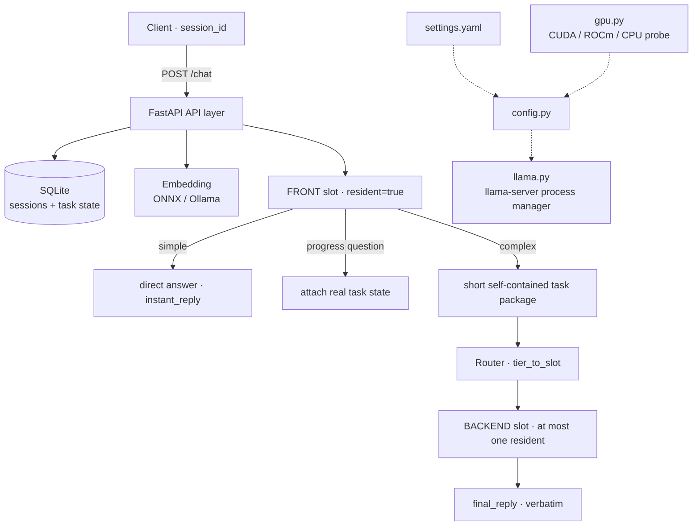
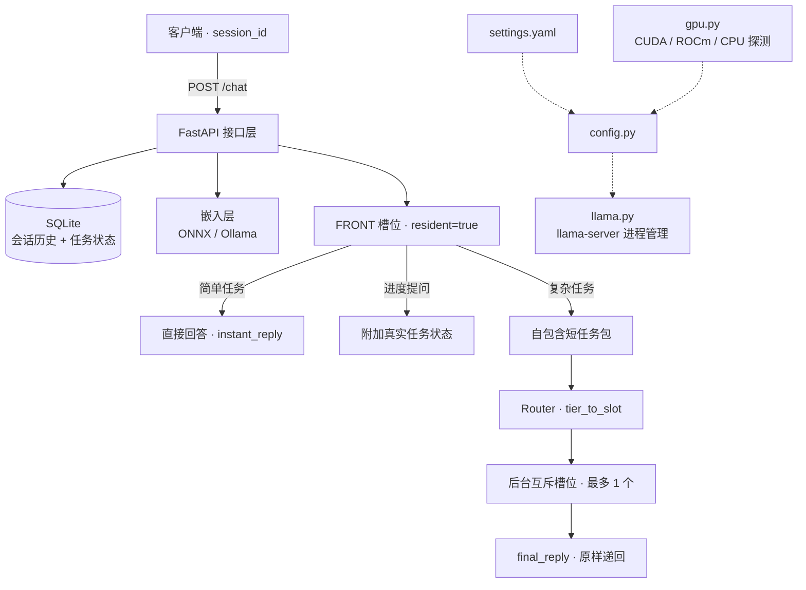

# explore · 智能本地路由

<p align="center">
  
</p>

### Intelligent Local LLM Router

> **中文**：一个完全跑在本地设备上的**配置驱动路由器**。前台常驻小模型始终与用户对话，简单任务当场答完；复杂任务按设备实时资源交给后台槽位里更合适的模型，结果原样递回。模型、显卡、上下文长度、端口全部来自一份 `settings.yaml`，代码里没有硬件常量，也没有固定模型名。
>
> **English**: A **configuration-driven router** that runs entirely on your own hardware. A small always-resident front model answers every single message and closes simple requests instantly; complex work is dispatched — based on live device resources — to a mutually-exclusive backend slot with a more capable model, and the result is handed back verbatim. Models, GPUs, context length and ports all come from one `settings.yaml`. No hardware constants and no hard-coded model names in the code.

**语言 / Language**: [English](#english) · [简体中文](#简体中文)

---

<a id="english"></a>

## English

### What this project is

`explore` is **not a model server and not a chatbot UI**. It is the decision layer in between: it decides *which local model should answer*, keeps one model permanently online so the conversation never stalls, and makes sure the device never runs out of VRAM while switching.

The original constraint was a single 16 GB GPU that could not hold several large models at once. The rewrite generalised that into two durable principles:

1. **A slot is a role, not a model.** `front` / `mid` / `moe` are identifiers. Which GGUF file, which quantisation, how much VRAM it needs and which GPU it lands on are all declared in `settings.yaml`. Slots can be added, removed or renamed.
2. **Hardware is a runtime fact, not a code constant.** GPU count, vendor, backend (CUDA / ROCm / CPU), free VRAM and the context ceiling are probed at startup. One NVIDIA card, one AMD card, two cards, or no GPU at all require **zero code changes**.

### Key capabilities

| Capability | Behaviour |
|---|---|
| **Every message gets a reply** | The resident front model always produces an `instant_reply`, even while a backend job is still running. |
| **Zero switching for simple work** | Requests routed to `front` are answered immediately; no backend process is ever loaded. |
| **Mutually-exclusive backend** | At most one backend model is resident. It may stay loaded; it is only replaced when a different tier is requested. |
| **Constant context window** | `num_ctx` is resolved once at startup and applied to every instance. Switching models never changes it. Minimum supported is **32K**. |
| **Verbatim result delivery** | Backend output is written to `final_reply` unchanged — the front model does not rewrite or summarise it. |
| **OpenAI-compatible** | `/v1/chat/completions`, `/v1/responses` and `/v1/models` work with Cherry Studio / Open WebUI / Dify: `final` mode waits for the backend, `instant` mode returns the front reply plus a `task_id`. |
| **Online API slots (v2.5)** | Any slot — including the resident front — can be `type: api`: an OpenAI-compatible cloud model or local Ollama. API slots use no local VRAM, never trigger slot switches, and can serve as a tier target, an extra tier, or a degrade fallback for local slots. **Upstream context length is auto-detected** (runtime window via /api/ps first, arch max as bound, min with declared; auto-shrinks on overflow/silent truncation). |
| **Embedding via Ollama (v2.6)** | `embedding.provider: onnx` (default, local ONNX, CPU) or `ollama` (e.g. `bge-m3`) — no local model files / numpy / onnxruntime needed; graceful fallback to keyword-only clues either way. |
| **N-tier routing (v2.5)** | `routing.tier_order` supports 3+ tiers with per-tier thresholds (`tier_thresholds`), per-tier keyword lists (`tier_complex_words`) and a per-tier degrade chain (`tier_fallbacks`). New tiers appear automatically as `explore-<tier>` model names. |
| **Hot config + Web console (v2.5)** | `GET /console` (single-file page, no external assets) + `/admin/config` hot-adjust ~19 runtime parameters (thresholds, word lists, output caps, system prompt, compaction…). Changes apply immediately and persist to `settings.local.yaml`; reset restores the `settings.yaml` base value. The「配置管理」panel edits startup params (slots/models/ports/num_ctx) with per-field comments, validates via a real import pre-check, and one-click restarts the service. |
| **CLI (v2.5)** | `python3 cli.py start/stop/status/health`, `config get/set/reset/validate`, `chat`, `task/tasks/models`, `logs`, `check-api <slot>` — stdlib only, mirrors `run.sh` semantics. |
| **Observable progress** | Asking "how is it going" attaches the real task state from SQLite, not a generated guess. |
| **Automatic VRAM guard** | `vram_plan` evaluates visible GPUs at startup. A slot that does not fit is marked `available: false`; heavy requests degrade to `default_slot` instead of OOM-ing. Multi-GPU layer split is derived from free VRAM at startup — no hard-coded ratio. |
| **Automatic context budget** | History budget scales with `num_ctx` and shrinks when the current input is long. Long chains stay stable and recall stays accurate. |
| **Compress before dropping** | When history exceeds the budget, early turns are rolling-summarised (preserving codenames verbatim) instead of being discarded; `context_usage.context_compressed` makes it observable. |
| **Portable** | No absolute device paths, no GPU indices, no model file names inside `app/`, `run.sh`, `tests/` or `.github/`. |

### Architecture



`gpu.py` probes the device, `config.py` resolves every slot's device list and split ratio from that probe plus `settings.yaml`, and `llama.py` only starts processes — it contains no hardware logic.

### Tech stack at a glance

| Layer | Choice |
|---|---|
| API | FastAPI 0.162.0 + Uvicorn 0.54.0 (single worker, async queue) |
| Async HTTP | httpx 0.28.1 |
| Inference runtime | `llama-server` (llama.cpp), GGUF, OpenAI-compatible endpoints |
| GPU backends | NVIDIA CUDA / AMD ROCm / CPU, auto-detected |
| Embedding | ONNX Runtime (local ONNX, CPU) or Ollama embeddings API (e.g. bge-m3, 1024-d) |
| State | SQLite (`messages` + `tasks`), no Redis / Celery / broker |
| Config | PyYAML 6.0.3, single `settings.yaml` + deployment-time env overrides |
| Numeric | numpy 2.2.6 |
| Process control | `run.sh` (idempotent start / stop / restart / status / health), PID file; `cli.py` (Python, stdlib only) |
| Tests | Real-machine Python test suite + shell matrix runner + CI static / GPU integration layers |

Full detail, version pinning rationale and alternatives: **[TECH_STACK.md](TECH_STACK.md)**.
Full step-by-step install: **[DEPLOYMENT.md](DEPLOYMENT.md)**.

### Quick start

```bash
# 1. Get the code
git clone https://github.com/liuda1999/explore-router.git
cd explore-router
mkdir -p models pylib data logs

# 2. Install pinned dependencies into the workspace (no system pollution, no venv required)
python3 -m pip install --target ./pylib -r requirements.txt

# 3. Place your GGUF models + ONNX embedding under models/, then edit settings.yaml
#    - slots.<key>.model      -> your GGUF path
#    - slots.<key>.vram_mb    -> measured weights + KV for YOUR device
#    - runtime.server_bin     -> path to llama-server
#    - context.num_ctx        -> auto (min 32K) or an explicit integer

# 4. Start (idempotent, foreground readiness wait, no boot-time autostart)
./run.sh start --wait          # or: python3 cli.py start --wait

# 5. Always confirm the *effective* configuration first
curl -s http://127.0.0.1:8100/config
curl -s http://127.0.0.1:8100/health

# 6. Optional: built-in Web console & CLI for hot parameter tuning
#    Browser: http://127.0.0.1:8100/console
python3 cli.py config validate
python3 cli.py config set FRONT_MAX_TOKENS 320   # applies immediately + persists
```

First request:

```bash
curl -s -X POST http://127.0.0.1:8100/chat \
  -H 'Content-Type: application/json' \
  -d '{"user_input":"What is 2+2?","session_id":"demo"}'

curl -s -X POST http://127.0.0.1:8100/chat \
  -H 'Content-Type: application/json' \
  -d '{"user_input":"Analyze and design a complete solution","session_id":"demo","prefer_tier":"heavy"}'

curl -s 'http://127.0.0.1:8100/task_result?task_id=<id>'
```

OpenAI-compatible clients (Cherry Studio, Open WebUI, Dify, ...) can point at the same router:

```bash
curl -s http://127.0.0.1:8100/v1/models

# default: wait for the backend task, return the complete result
curl -s -X POST http://127.0.0.1:8100/v1/chat/completions \
  -H 'Content-Type: application/json' \
  -d '{"model":"explore","messages":[{"role":"user","content":"What is 2+2?"}]}'

# instant mode: return the front-model reply immediately and expose task_id
curl -s -X POST http://127.0.0.1:8100/v1/chat/completions \
  -H 'Content-Type: application/json' \
  -d '{"model":"explore-fast","messages":[{"role":"user","content":"Analyze and design a complete solution"}]}'

# streaming: chunked SSE, not token-by-token
curl -sN -X POST http://127.0.0.1:8100/v1/chat/completions \
  -H 'Content-Type: application/json' \
  -d '{"model":"explore","stream":true,"messages":[{"role":"user","content":"Hello"}]}'

# Responses API (newer OpenAI protocol): input / output[] / previous_response_id
curl -s -X POST http://127.0.0.1:8100/v1/responses \
  -H 'Content-Type: application/json' \
  -d '{"model":"explore","input":"What is 2+2?"}'

# multi-turn through server-side state
curl -s -X POST http://127.0.0.1:8100/v1/responses \
  -H 'Content-Type: application/json' \
  -d '{"model":"explore","input":"And the previous answer times 2?","previous_response_id":"resp_..."}'
```

Stop cleanly (only this project's PID and configured ports are touched):

```bash
./run.sh stop
```

> Replace the model files, GPU and context values with whatever your machine actually has. The values shipped in `settings.yaml` are **examples**, not requirements.

### Verified status

Audited on real hardware with real models, real process crashes and real restarts — **no mocks**: API contract 27/27, fault injection 10/10, restart recovery 10/10, stability 10/10, long-context 15/15 per context tier, 32K/64K/96K matrix 69/69, OpenAI compatibility **38/38** (chat/completions) and **41/41** (Responses), pre-release acceptance **93/93** (including compaction and early recall), single-GPU degradation verified, CI `STATIC_OK + INTEGRATION_OK`. v2.5 additions (any machine, no GPU needed): api-slot full pipeline **21/21** (`tests/test_api_slot.py`), admin & settings-editor & restart **34/34** (`tests/test_admin_api.py`, includes two real restarts), CLI **9/9** (`tests/test_cli.py`), config static checks **23/23**, paragraph-truncation behavior **10/10** (`tests/test_truncation_behavior.py`), real-model smoke with local Ollama **31/31** (`tests/test_real_model_smoke.py`). See [AUDIT_REPORT.md](AUDIT_REPORT.md) and [ACCEPTANCE_REPORT.md](ACCEPTANCE_REPORT.md). All performance figures there are **device-specific historical measurements**, not project limits.

### Documentation

| Document | Content |
|---|---|
| [README.md](README.md) | This bilingual entry point |
| [PROJECT_INTRO.en.md](PROJECT_INTRO.en.md) | Full project introduction (English) |
| [PROJECT_INTRO.md](PROJECT_INTRO.md) | 完整项目介绍（中文） |
| [TECH_STACK.md](TECH_STACK.md) | Technology stack, component choices, version matrix |
| [DEPLOYMENT.md](DEPLOYMENT.md) | Deployment & startup runbook, hardware scenarios, acceptance checklist |
| [OPERATIONS.md](OPERATIONS.md) | Day-2 operations: swap models / devices, monitoring, troubleshooting, rollback |
| [AUDIT_REPORT.md](AUDIT_REPORT.md) | Full real-machine audit and CI results |
| [CODE_AUDIT_REPORT.md](CODE_AUDIT_REPORT.md) | v2.5.0 static code audit (no-GPU): 28 findings fixed, security/Concurrency/Portability |
| [ACCEPTANCE_REPORT.md](ACCEPTANCE_REPORT.md) | Pre-release acceptance stress test: long context, concurrency, streaming, log checks |
| [TEST_REPORT.md](TEST_REPORT.md) | Historical device-specific measurements |
| [docs/PROJECT_PLAN.md](docs/PROJECT_PLAN.md) | Historical development log (requirements evolution, not a current constraint) |
| [settings.yaml](settings.yaml) | The single source of truth |

### Current boundaries

No authentication, no rate limiting, no automatic log/database rotation — the API binds to `127.0.0.1` and expects a reverse proxy with auth if exposed. SSE is chunked rather than token-by-token, because the upstream `llama-server` call is non-streaming. When output hits `max_tokens`, responses report `finish_reason=length` (`/v1/responses` reports `status=incomplete`). AMD ROCm is validated at the config/parse layer but not yet on physical AMD hardware. Details in [PROJECT_INTRO.en.md](PROJECT_INTRO.en.md), section "Known limitations".

### License

Released under the [Apache License 2.0](LICENSE). Copyright 2026 liuda1999.

You may use, modify and redistribute this project, including commercially, provided you retain the copyright and license notices. The license also grants an explicit patent license and requires prominent notices for significant modifications.

---

<a id="简体中文"></a>

## 简体中文

### 项目是什么

`explore` **不是模型服务，也不是聊天界面**，而是夹在用户与本地模型之间的决策层：决定「由哪个本地模型来回答」，让一个模型永久在线以保证对话不中断，并在切换模型时保证设备显存不被撑爆。

最初的约束是「一张 16G 显卡放不下多个大模型」。重写时把它抽象成两条稳定原则：

1. **槽位是角色，不是模型**。`front` / `mid` / `moe` 只是标识；装哪个 GGUF、什么量化、需要多少显存、落在哪张卡，全部在 `settings.yaml` 里声明，槽位可增删改名。
2. **硬件是运行时事实，不是代码常量**。GPU 数量、品牌、后端（CUDA / ROCm / CPU）、空闲显存、上下文上限都在启动时探测；单卡 N 卡、单卡 A 卡、双卡、无 GPU 都**不需要改代码**。

### 核心能力

| 能力 | 行为 |
|---|---|
| **句句有着落** | 常驻前台模型每次都产出 `instant_reply`，即使后台任务还在跑。 |
| **简单任务零切换** | 路由到 `front` 的请求当场答完，不加载任何后台进程。 |
| **后台互斥槽位** | 最多一个后台模型驻留；允许一直常驻，只在需要另一档时才换掉。 |
| **上下文恒定** | `num_ctx` 启动时解析一次并应用到所有实例，切换模型不改变它；最低支持 **32K**。 |
| **结果原样递回** | 后台输出直接写入 `final_reply`，前台不改写、不整理。 |
| **OpenAI 兼容** | `/v1/chat/completions`、`/v1/responses`、`/v1/models` 可直接接入 Cherry Studio / Open WebUI / Dify：`final` 模式等后台完成，`instant` 模式立即回即时回复并给 `task_id`。 |
| **线上 API 槽位（v2.5）** | 任意槽位——包括常驻前台——都可以是 `type: api`：OpenAI 兼容云端模型或本机 Ollama。api 槽位不占本地显存、不触发槽位切换，可作为档位映射目标、新增档位或本地槽位的降级备选。**上游上下文长度自动探测**（运行时窗口优先，超限/静默截断自动收缩）。 |
| **嵌入模型可接 Ollama（v2.5）** | `embedding.provider: onnx`（默认，本地 ONNX，CPU）或 `ollama`（如 `bge-m3`）——无需本地模型文件 / numpy / onnxruntime；任一 provider 失败都降级为纯文本线索。 |
| **N 档分级（v2.5）** | `routing.tier_order` 支持 3+ 档：每档阈值（`tier_thresholds`）、每档专属词表（`tier_complex_words`）、每档降级链（`tier_fallbacks`）全部可配；新档位自动出现 `explore-<档位>` 模型名。 |
| **热参数 + Web 控制台（v2.5）** | `GET /console`（单文件页面、无外部资源）+ `/admin/config` 可热调约 19 个运行期参数（分级阈值、词表、输出上限、system 提示词、压缩参数…），立即生效并持久化到 `settings.local.yaml`；重置恢复 settings.yaml 基础值。「配置管理」面板带注释编辑全部启动期参数（槽位/模型/端口/num_ctx），保存前真实导入预检，并支持一键重启。 |
| **CLI（v2.5）** | `python3 cli.py start/stop/status/health`、`config get/set/reset/validate`、`chat`、`task/tasks/models`、`logs`、`check-api <槽位>`——仅标准库，与 run.sh 同一套语义。 |
| **进度可观测** | 用户问进度时附加来自 SQLite 的真实任务状态，而不是模型编造。 |
| **显存自动阈值** | `vram_plan` 按启动期可见 GPU 判断；装不下的槽位标 `available: false`，heavy 自动降级到 `default_slot`，不强行加载导致 OOM。多卡分层比例按启动期空闲显存自动推导，不写死。 |
| **上下文自动预算** | 历史预算随 `num_ctx` 伸缩，当前输入变长时自动收紧，保证长链路稳定与召回准确。 |
| **先压缩再丢弃** | 历史超预算时，把早期轮次滚动摘要保留（暗号逐字保留），而不是直接丢弃；`context_usage.context_compressed` 可观测。 |
| **可移植** | `app/`、`run.sh`、`tests/`、`.github/` 内无设备绝对路径、无显卡索引、无模型文件名硬编码。 |

### 架构



`gpu.py` 探测设备，`config.py` 依据探测结果与 `settings.yaml` 解析每个槽位的设备列表与分层比例，`llama.py` 只负责起停进程，不含任何硬件判断。

### 技术栈速览

| 层次 | 选型 |
|---|---|
| 接口 | FastAPI 0.162.0 + Uvicorn 0.54.0（单 worker + asyncio 队列） |
| 异步 HTTP | httpx 0.28.1 |
| 推理运行时 | `llama-server`（llama.cpp），GGUF，OpenAI 兼容接口 |
| GPU 后端 | NVIDIA CUDA / AMD ROCm / CPU，启动期自动探测 |
| 嵌入 | ONNX Runtime 1.23.2 + tokenizers 0.23.3（中文 bge，1024 维，CPU 执行） |
| 状态 | SQLite（`messages` + `tasks`），无 Redis / Celery / 消息中间件 |
| 配置 | PyYAML 6.0.3，唯一 `settings.yaml` + 部署期环境变量覆盖 |
| 数值 | numpy 2.2.6 |
| 进程管理 | `run.sh`（幂等 start / stop / restart / status / health）+ PID 文件；`cli.py`（Python，仅标准库） |
| 测试 | 真机 Python 用例 + Shell 矩阵 + CI 静态层 / GPU 集成层 |

完整选型理由、版本固定原因与替代方案见 **[TECH_STACK.md](TECH_STACK.md)**；从零部署步骤见 **[DEPLOYMENT.md](DEPLOYMENT.md)**。

### 快速开始

```bash
# 1. 获取代码
git clone https://github.com/liuda1999/explore-router.git
cd explore-router
mkdir -p models pylib data logs

# 2. 把固定版本依赖装进工作区（不污染系统，不需要 venv）
python3 -m pip install --target ./pylib -r requirements.txt

# 3. 把 GGUF 模型与 ONNX 嵌入模型放进 models/，然后编辑 settings.yaml：
#    - slots.<key>.model     改成你的 GGUF 路径
#    - slots.<key>.vram_mb   填目标机实测的「权重 + KV」显存
#    - runtime.server_bin    改成 llama-server 的实际路径
#    - context.num_ctx       auto（最低 32K）或显式整数

# 4. 启动（幂等；--wait 等待前台就绪；不设开机自启）
./run.sh start --wait          # 或：python3 cli.py start --wait

# 5. 换模型/换设备后，先确认「实际生效」的配置
curl -s http://127.0.0.1:8100/config
curl -s http://127.0.0.1:8100/health

# 6. 可选：内置 Web 控制台与 CLI 热调参数
#    浏览器打开：http://127.0.0.1:8100/console
python3 cli.py config validate
python3 cli.py config set FRONT_MAX_TOKENS 320   # 立即生效并持久化
```

第一个请求：

```bash
curl -s -X POST http://127.0.0.1:8100/chat \
  -H 'Content-Type: application/json' \
  -d '{"user_input":"2+2 等于几","session_id":"demo"}'

curl -s -X POST http://127.0.0.1:8100/chat \
  -H 'Content-Type: application/json' \
  -d '{"user_input":"请详细分析并给出完整方案","session_id":"demo","prefer_tier":"heavy"}'

curl -s 'http://127.0.0.1:8100/task_result?task_id=<id>'
```

OpenAI 兼容客户端（Cherry Studio、Open WebUI、Dify 等）可直接指向同一个路由：

```bash
curl -s http://127.0.0.1:8100/v1/models

# 默认：等后台任务完成，返回完整结果
curl -s -X POST http://127.0.0.1:8100/v1/chat/completions \
  -H 'Content-Type: application/json' \
  -d '{"model":"explore","messages":[{"role":"user","content":"2+2 等于几"}]}'

# instant：立即返回前台即时回复，并给出 task_id
curl -s -X POST http://127.0.0.1:8100/v1/chat/completions \
  -H 'Content-Type: application/json' \
  -d '{"model":"explore-fast","messages":[{"role":"user","content":"请详细分析并给出完整方案"}]}'

# 流式：分块 SSE，不是逐 token
curl -sN -X POST http://127.0.0.1:8100/v1/chat/completions \
  -H 'Content-Type: application/json' \
  -d '{"model":"explore","stream":true,"messages":[{"role":"user","content":"你好"}]}'

# Responses API（OpenAI 新协议）：input / output[] / previous_response_id
curl -s -X POST http://127.0.0.1:8100/v1/responses \
  -H 'Content-Type: application/json' \
  -d '{"model":"explore","input":"2+2 等于几"}'

# 多轮：用 previous_response_id 续接服务端会话
curl -s -X POST http://127.0.0.1:8100/v1/responses \
  -H 'Content-Type: application/json' \
  -d '{"model":"explore","input":"刚才的结果乘以 2 是多少","previous_response_id":"resp_..."}'
```

停止（只处理本项目 PID 与配置中的端口，不做全局清理）：

```bash
./run.sh stop
```

> 请把模型文件、显卡与上下文值替换成自己设备的真实情况。`settings.yaml` 里的具体数值只是**示例**，不是运行要求。

### 验证状态

真机、真模型、真实进程故障与真实重启审计，**全程不使用 mock**：API 契约 27/27、故障注入 10/10、重启恢复 10/10、稳定性 10/10、长上下文每档 15/15、32K/64K/96K 矩阵 69/69、OpenAI 兼容层 **38/38**（chat/completions）与 **41/41**（Responses）、发布前验收压测 **93/93**（含上下文压缩与早期召回）、单卡降级已验证、CI `STATIC_OK + INTEGRATION_OK`。v2.5 新增（任意机器、无需 GPU）：api 槽位全链路 **21/21**（`tests/test_api_slot.py`）、管理接口+配置管理+重启 **34/34**（`tests/test_admin_api.py`，含两次真实重启）、CLI **9/9**（`tests/test_cli.py`）、配置静态检查 **23/23**、段落边界截断行为 **10/10**（`tests/test_truncation_behavior.py`）、本机 Ollama 真实模型冒烟 **31/31**（`tests/test_real_model_smoke.py`）。详见 [AUDIT_REPORT.md](AUDIT_REPORT.md) 与 [ACCEPTANCE_REPORT.md](ACCEPTANCE_REPORT.md)。其中所有性能数字都是**特定设备的历史实测**，不是项目约束或能力边界。

### 文档索引

| 文档 | 内容 |
|---|---|
| [README.md](README.md) | 本双语总入口 |
| [PROJECT_INTRO.md](PROJECT_INTRO.md) | 完整项目介绍（中文） |
| [PROJECT_INTRO.en.md](PROJECT_INTRO.en.md) | Full project introduction (English) |
| [TECH_STACK.md](TECH_STACK.md) | 技术栈、组件选型、版本矩阵 |
| [DEPLOYMENT.md](DEPLOYMENT.md) | 部署与启动流程、硬件场景、验收清单 |
| [OPERATIONS.md](OPERATIONS.md) | 日常运维：换模型 / 换设备、监控、排障、回滚 |
| [AUDIT_REPORT.md](AUDIT_REPORT.md) | 全量真机审计与 CI 结果 |
| [CODE_AUDIT_REPORT.md](CODE_AUDIT_REPORT.md) | v2.5.0 代码审计（无 GPU 静态+全链路）：28 项发现全部修复 |
| [ACCEPTANCE_REPORT.md](ACCEPTANCE_REPORT.md) | 发布前验收压测：长上下文、并发、流式、日志核查 |
| [TEST_REPORT.md](TEST_REPORT.md) | 特定设备的历史实测 |
| [docs/PROJECT_PLAN.md](docs/PROJECT_PLAN.md) | 历史开发记录（需求演进，非当前约束） |
| [settings.yaml](settings.yaml) | 唯一配置源 |

### 当前边界

无鉴权、无速率限制、无日志/数据库自动轮转——默认绑定 `127.0.0.1`，对外暴露必须加反向代理与鉴权。SSE 为分块发送而非逐 token 流式（底层 `llama-server` 调用非流式）。输出撞到 `max_tokens` 时返回 `finish_reason=length`（`/v1/responses` 返回 `status=incomplete`）。AMD ROCm 已完成代码与配置解析层验证，尚未在 AMD 真机上实测。详见 [PROJECT_INTRO.md](PROJECT_INTRO.md)「已知限制」。

### 许可证

本项目采用 [Apache License 2.0](LICENSE) 发布，版权归 liuda1999 所有（2026）。

允许商用、修改与再分发，但须保留版权与许可声明；该许可证同时包含明确的专利授权，并要求对重大修改做出显著说明。
