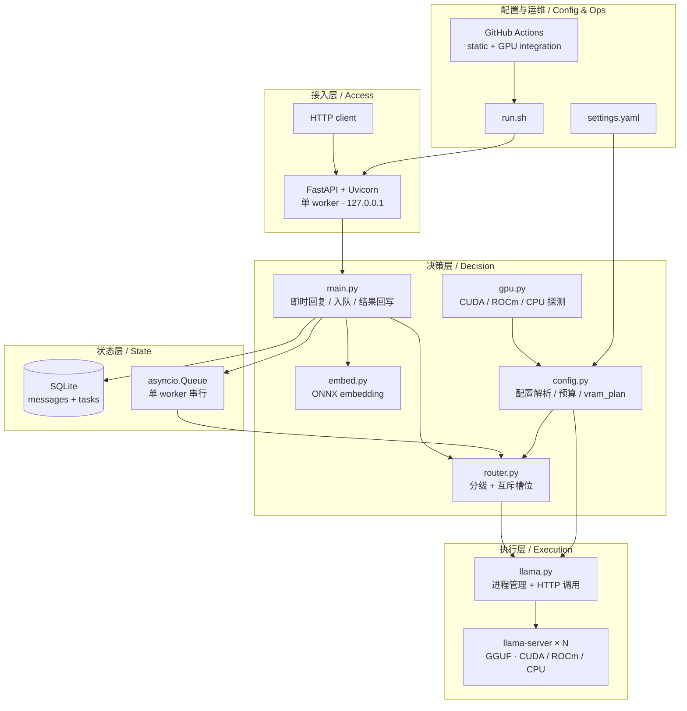

# explore 智能本地路由 — 技术栈

> **English summary**: This document explains the full technology stack of `explore`, why each component was chosen, what the pinned versions are, how the layers interact, and what the compatibility matrix looks like. For the short version see [README.md](README.md); for installation see [DEPLOYMENT.md](DEPLOYMENT.md).
>
> **版本** v2.3.0 ｜ **更新** 2026-11-08 ｜ 依赖固定清单见 [requirements.txt](requirements.txt)

---

## 1. 一句话概括

**Python 异步服务 + 本地 llama.cpp 推理进程 + SQLite 状态 + 单份 YAML 配置**，外加一层 ONNX 嵌入做语义线索。没有消息中间件、没有容器编排、没有系统服务、没有云依赖——所有组件都能在一台离线设备上跑起来。

---

## 2. 分层视图 / Layered view



**依赖方向是单向的**：执行层不知道决策层的存在，决策层不知道具体设备型号，配置层是唯一把「这台机器长什么样」翻译给其它层的桥梁。

`app/prompts.py` 是独立的**消息模板层**：后台 system、任务包、结果/进度前缀、截断标记、降级文案全部集中定义，带 `PROMPT_VERSION` 版本标记。业务代码不再内联拼接跨模块文本，改模板只改这一个文件。

---

## 3. 组件清单与固定版本 / Component inventory

| 层次 | 组件 | 固定版本 | 作用 | 为什么选它 |
|---|---|---|---|---|
| 接口 | FastAPI | 0.162.0 | HTTP 路由、请求校验（`pydantic`）、`lifespan` 生命周期 | 自带 OpenAPI 契约、异步原生、依赖少；比 Flask 更适合同时管理长任务与即时响应 |
| 接口 | Uvicorn | 0.54.0 | ASGI 服务器，单 worker | 单进程才能安全持有 `asyncio.Queue` 与 SQLite 连接；多 worker 会破坏后台槽位互斥 |
| 接口 | websockets | 16.1.1 | Uvicorn 的 WS 依赖 | 目标机系统自带旧版会与 Uvicorn 冲突；固定装进 `pylib` 隔离 |
| HTTP 客户端 | httpx | 0.28.1 | 调用本地 `llama-server` | 原生 async、超时与连接池可控；同步库会阻塞前台即时回复 |
| 配置 | PyYAML | 6.0.3 | 解析 `settings.yaml` | 人类可读、注释友好；配置是给人改的，不是给程序生成的 |
| 数值 | numpy | 2.2.6 | embedding 向量归一化与计算 | ONNX Runtime 输出的数组处理 |
| 嵌入推理 | ONNX Runtime | 1.23.2 | CPU 上跑量化 ONNX 嵌入模型 | **不占 GPU 显存**，这正是「小显存设备」的关键；无需 PyTorch 全家桶 |
| 分词 | tokenizers | 0.23.3 | 嵌入模型分词 | 轻量、与 HuggingFace tokenizer.json 兼容 |
| 状态 | SQLite（Python 标准库 `sqlite3`） | 随 Python | 会话历史 + 任务状态机 | 零部署成本、事务可靠、重启可恢复；这个项目不需要分布式存储 |
| 并发 | `asyncio.Queue` | 标准库 | 后台任务单队列 | 串行执行使后台槽位天然互斥，不需要锁或 broker |
| 推理运行时 | `llama-server`（llama.cpp） | 由目标机提供 | 加载 GGUF、提供 OpenAI 兼容接口 | 直接读 GGUF、显存控制参数丰富（`-ts` 分层、KV 精度）、无需守护进程或账号 |
| GPU 探测 | `nvidia-smi` / `rocm-smi` | 系统工具 | 后端识别、卡数、显存 | 不引入 Python GPU 绑定库，跨 N 卡 / A 卡都能工作 |
| 进程管理 | Bash + PID 文件 | — | 幂等启停 | 精确控制本项目进程，避免全局清理误伤其它服务 |
| 测试 | pytest | 9.2.0 | 用例组织 | 与自研真机脚本并存，便于在 CI 里扩展 |
| CI | GitHub Actions | — | 静态层 + GPU 集成层 | 静态层任意机器可跑；集成层跑带 `gpu` 标签的 self-hosted runner |

> **版本固定的原因**：早期踩过「系统旧 websockets 与 Uvicorn 冲突」「tokenizers 参数不兼容导致 embedding 静默降级」两个坑。`requirements.txt` 全部用 `==` 锁定，`tests/check_portability.py` 会在 CI 静态层检查任何未固定版本的依赖行。

### 明确没有引入的东西

| 未引入 | 原因 |
|---|---|
| Redis / Celery / 消息队列 | 单机单进程即可串行化后台任务；引入 broker 会带来状态不同步与配额泄漏的历史问题 |
| Ollama 等托管模型服务 | 需要额外下载与守护进程；`llama-server` 直接加载 GGUF 更轻、更可控（接口已隔离，可换回） |
| PyTorch / Transformers 全家桶 | 只为跑一个小嵌入模型不值得占显存与磁盘；ONNX Runtime CPU 执行足够 |
| 向量数据库 / 跨会话检索层 | 主会话归前台，后台是无状态执行器；历史按 `num_ctx` 自动预算即可 |
| Docker / Kubernetes | 目标是「一台本地设备、手动启停」；容器化会掩盖 GPU 可见性与显存真实情况 |
| 鉴权框架 / API 网关 | 默认只绑 `127.0.0.1`；对外暴露应由反向代理负责，不在本项目内重复实现 |

---

## 4. 推理运行时接口约定 / Runtime contract

`app/llama.py` 是唯一与推理运行时对话的模块，其余代码不感知运行时细节。它依赖的能力很窄，换运行时只需满足这几条：

| 能力 | 当前用法 |
|---|---|
| 命令行启动 | `server_bin` + `--model` `-c` `--host` `--port` `-ngl` `--cache-type-k/v` `-ts` 等参数 |
| OpenAI 兼容 `POST /v1/chat/completions` | 主要调用路径，带 `chat_template_kwargs` 关闭 thinking |
| `POST /completion` 兜底 | 当 thinking 模型把正文写进 `reasoning_content`、`content` 为空时降级使用 |
| 健康检查 | 端口可连接即认为就绪，配合 `startup_timeout_s` |
| 日志可观测 | 每个槽位独立日志文件，`n_ctx_slot` 用于验证上下文恒定 |

**两个关键兼容处理**（都是真机实测踩出来的）：

1. **thinking 模型**：部分 Qwen 系 GGUF 会把正文放进 `reasoning_content` 而 `content` 为空，导致「后台结果为空」。调用层统一传 `enable_thinking: false`，并在空正文时降级到 `/completion`。
2. **KV cache 精度**：大上下文下前台 f16 KV 会挤占后台显存导致 `cudaMalloc out of memory`。`context.kv_cache` 允许设为 `q8_0` 等量化精度，**只压缩 KV，不改变 `num_ctx`**。

---

## 5. GPU 后端抽象 / Backend abstraction

`app/gpu.py` 在启动期生成一次快照（带缓存），输出：后端类型、可见卡列表、每卡型号/总显存/空闲显存。

| 后端 | 探测依据 | 可见设备变量 | 备注 |
|---|---|---|---|
| `cuda` | `nvidia-smi` 可用且能解析出卡 | `CUDA_VISIBLE_DEVICES` | 尊重外部已设置的可见性，容器只挂一张卡时按单卡规划 |
| `rocm` | `rocm-smi` 可用 | `HIP_VISIBLE_DEVICES` / `ROCR_VISIBLE_DEVICES` | 单卡 A 卡走这条路径 |
| `cpu` | 两者都探测不到 | 不设置 | 不阻止启动，`/config` 中会标明 |

`config.py` 基于快照计算 `vram_plan`：

```
可用显存 = 可见卡 free_mb 之和 − 前台常驻预估占用 − reserve_system_mb − headroom
装不下的槽位 → available: false + reason
heavy 请求 → 自动降级到 routing.default_slot
```

**静态规划 + 加载前复查**：槽位选择阶段用静态 `VRAM_PLAN`（不把正要被换掉的驻留模型算进占用，避免误降级），真正 `llama-server` 启动前再由 `llama.py` 复查一次实际显存。

多卡分层：`placement: spread` 的槽位跨所有可见卡，`-ts` 比例默认按「各卡空闲显存 − 前台预估占用」计算，可用 `slots.<key>.split_ratio` 显式覆盖。单卡时自动退化为单卡，不启用分层参数。

---

## 6. 数据流与并发模型 / Data flow & concurrency

```
请求 → FastAPI（单 worker）
     ├─ 前台推理（httpx async）→ instant_reply 立即返回
     └─ 复杂任务 → SQLite pending → asyncio.Queue → 单 worker 串行
                                  → 槽位 ensure()（停旧启新 / 复用）
                                  → 后台推理 → final_reply 原样写回
```

| 决策 | 取舍 |
|---|---|
| 单 worker | 保证队列、槽位状态、SQLite 连接都在同一进程内，无需分布式锁；代价是后台任务串行 |
| 单队列 | 「最多一个后台模型驻留」由执行顺序天然保证；代价是高优先级任务不能插队 |
| embedding 在 CPU | 不占用已经紧张的显存；代价是每次请求多一次 CPU 推理（本地毫秒级） |
| 短任务包 | 后台只拿「任务描述 + 关键词 + 输出要求」，不灌完整会话；避免重复 prefill 与上下文膨胀 |
| 历史自动预算 | 长链路稳定、召回准确；超出预算的早期轮次不可召回 |

---

## 7. 兼容矩阵 / Compatibility matrix

| 维度 | 支持情况 | 验证状态 |
|---|---|---|
| Python | 3.10+（目标机 3.10.12 实测） | 已验证；用 `pip --target` 安装，不依赖 `python3-venv` |
| 操作系统 | Linux（Ubuntu 22.04 实测）；脚本为 Bash | Windows 仅用于文档/代码编辑，不作为运行目标 |
| GPU 后端 | CUDA / ROCm / CPU | CUDA 真机全量验证；ROCm 完成代码与配置解析层验证，**未做 AMD 真机实测**；CPU 后端做了探测与显式越界检查 |
| 显卡数量 | 单卡 / 多卡 | 双卡全量 + 单卡（20G）阈值降级均验证 |
| 上下文 | 最低 32K，`num_ctx: auto` 按显存查表或显式整数 | 32K / 64K / 96K 在某双卡设备各 23/23 断言通过；换设备需重测 |
| 模型格式 | GGUF（任意量化；稠密或 MoE 均可） | 3B / 9B / 35B MoE 真机验证；换模型只改配置 |
| 嵌入模型 | ONNX + tokenizer.json（当前中文 bge，1024 维） | 启动自检 1024 维；换模型只改 `embedding` 段 |
| 端口 | `runtime.ports` 三个端口可配，环境变量可覆盖 | 默认 8100 / 18100 / 18101 |
| 依赖安装 | `pip --target ./pylib`，无需 root / venv | `requirements.txt` 全部固定版本 |

> 所有「已验证」都指真机真模型，不使用 mock。设备相关数字见 [AUDIT_REPORT.md](AUDIT_REPORT.md) 与 [TEST_REPORT.md](TEST_REPORT.md)，**它们不是项目约束**。

---

## 8. 可复现性与移植性保障 / Reproducibility & portability

| 机制 | 实现 |
|---|---|
| 依赖锁定 | `requirements.txt` 全部 `==`；`tests/check_portability.py` 检查未固定版本 |
| 换行符统一 | `.gitattributes` 强制 `*.sh` 等为 LF，避免 Windows checkout 后脚本不可执行 |
| 无硬编码 | `tests/check_portability.py` 扫描 `app/`、`run.sh`、`tests/`，禁止设备绝对路径、具体模型文件名、显卡型号、硬编码多卡索引 |
| 配置驱动 | `settings.yaml` 是唯一配置源；`GET /config` 输出实际生效值，消除「文档写的」与「实际跑的」不一致 |
| 文档一致性 | `tests/check_docs.py` 校验文档提到的端点确实注册、配置段确实存在、无旧项目名残留 |
| CI 双层 | 静态层任意机器；GPU 集成层自托管 runner，独立端口/数据目录、结束自动停服 |

---

## 9. 安全边界 / Security boundary

| 项 | 现状 |
|---|---|
| 监听地址 | `127.0.0.1`，不对外 |
| 鉴权 / 限流 | 无；对外暴露必须加反向代理 + 鉴权 + TLS |
| 输入保护 | `routing.max_input_chars`（413）、`runtime.queue_maxsize`（429） |
| 进程操作 | 只按 PID 文件与配置端口管理本项目进程；禁止全局 `pkill`、禁止开机自启 |
| 凭据 | 仓库不含密钥、模型权重、日志、数据库；`.gitignore` 排除 `.env` / `*.key` / `*.pem` / 私钥等 |
| 数据留存 | 会话与任务存本地 SQLite，无自动清理；生产环境需 logrotate 与定期归档 |

---

## 10. 相关文档

- [DEPLOYMENT.md](DEPLOYMENT.md) — 把这些组件真正装起来并跑通
- [OPERATIONS.md](OPERATIONS.md) — 日常运维、`settings.yaml` 字段全表
- [PROJECT_INTRO.md](PROJECT_INTRO.md) / [PROJECT_INTRO.en.md](PROJECT_INTRO.en.md) — 设计、架构、取舍
- [AUDIT_REPORT.md](AUDIT_REPORT.md) — 真机验证与 CI 结果
- [.github/workflows/ci.yml](.github/workflows/ci.yml) — CI 定义
